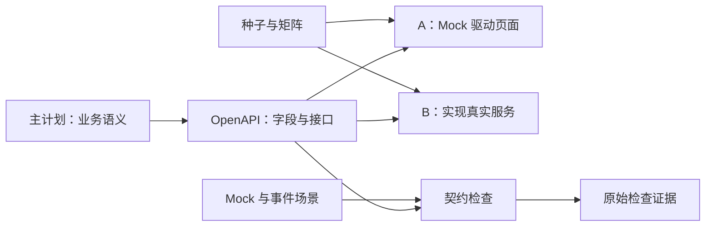
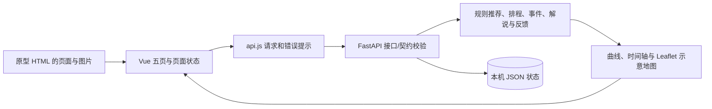
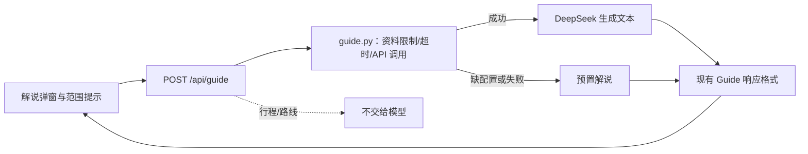
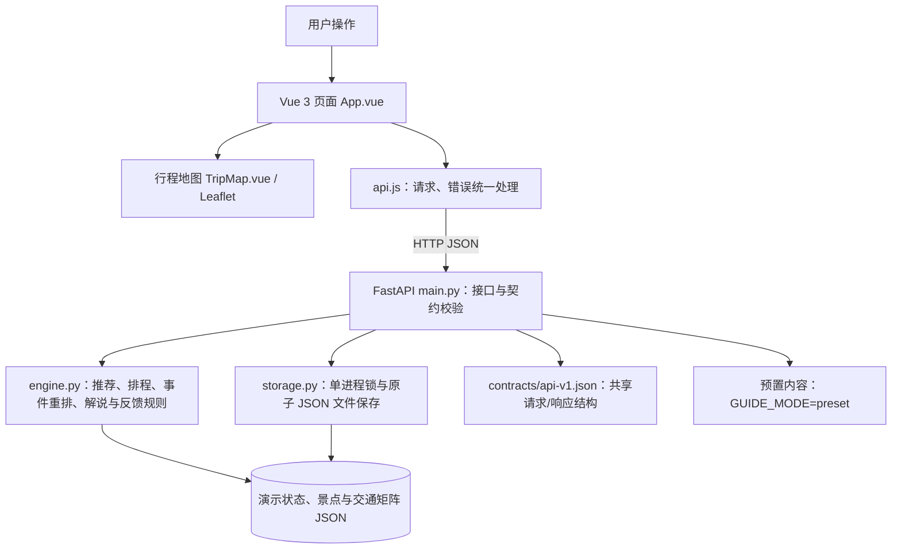

# 旅伴 AI Demo 实现与验收报告

更新日期：2026 年 11 月 21 日。第 1 阶段（开发契约准备）与第 2 阶段（本机功能 Demo 实现）已完成；真实模型、正式地图服务与生产部署不在本阶段范围。

## 1 本阶段目标与前后变化

此前只有产品计划和二人分工，字段、事件参数、候选确认等仍需要两人临时协商。本阶段把可提前确定的开发约定固定下来：A 可以直接拿样例制作页面，B 可以直接按照接口和业务规则实现后端，避免各自设计一套格式。

本节回顾的是 2026 年 11 月 18 日完成的契约准备阶段：当时仅完成第 11 节契约及其支持文件，尚未构建 Vue/FastAPI 应用。后续实现和验收记录见本报告第 10 节。

## 2 实际交付与入口

| 交付 | 实际能力 |
|---|---|
| [主计划第 11 节](D:/pm/旅伴AI_MVP实现计划.md) | 字段单位、时间、评分、排程、事件、确认、附近、反馈、运行和交接语义 |
| [OpenAPI 契约](D:/pm/contracts/api-v1.json) | 16 个操作、33 个数据结构，包含必填、枚举、输入输出与错误 |
| [Mock 索引](D:/pm/contracts/mock/index.json) | 35 个界面开发样例，覆盖成功、无结果、失败、备用解说和重复反馈 |
| [事件场景](D:/pm/contracts/scenarios.json) | 五类事件请求与预期性质，另含重复事件和倒退时间的失败场景 |
| [景点种子](D:/pm/contracts/attractions.seed.json) | 当前香格里拉 14 个原型景点及未外部核验的来源说明 |
| [交通矩阵](D:/pm/contracts/travel_times.json) | start 和 14 个地点之间完整 15×15 固定估算矩阵 |
| [初始状态](D:/pm/contracts/demo_state.seed.json) | 一个演示用户的偏好、条件、时刻和空行程 |
| [配置](D:/pm/contracts/runtime-config.json) | 端口、前端模式、超时和模型配置占位 |
| [检查脚本](D:/pm/contracts/validate.mjs) | 无第三方依赖，读取契约与样例并输出结构检查证据 |

OpenAPI 是描述 HTTP 接口的标准文件；Mock 是与真实返回格式相同的固定样例。本阶段新增这些文件，未复用任何已核实的业务实现。Node 内置文件能力用于编写与检查 JSON，没有安装项目依赖；后续 Python 运行仍须使用计划规定的专属 Conda 环境。

## 3 结构与职责



计划解释业务怎么处理；OpenAPI 固定怎么传数据；样例服务于页面开发；种子为后端提供起点；检查脚本防止结构明显偏离。它们不代替最终真实接口联调，也不构成第二套产品架构。

## 4 一个任务如何贯穿这些交付

以完成首个景点后延误 40 分钟并疲劳为例：

1. A 从 `status-complete.json` 的 `response.data` 取得已完成节点快照，用于展示时间轴。
2. 提交参数使用 `replan-delay-fatigue.json` 的 request：包含事件、延误前的 now 和当前位置。
3. B 按主计划第 11.4 节计算：now 加 40 分钟、排除未来高强度点、冻结历史、检查剩余时间，返回 State 中的 proposal。
4. A 比较正式 trip 和 proposal.trip，不在确认前覆盖地图正式路线。
5. 用户确认后调用 `/api/replan/confirm` 并带 proposalId，用返回的 State 更新界面。

以上是开发和使用教程。本轮检查只验证相关样例结构，尚未实际执行步骤 3 的算法。

## 5 核心文件与实现说明

**接口契约：**输入是冻结的需求，输出为请求响应结构。所有定义通过 `$ref` 引用复用对象，减少两人对 State、Trip 的重复解释。请求未知字段拒绝，业务时间和状态约束由主计划补充。验证了引用存在和所有操作有样例。

**Mock：**每个场景包含 operationId、method、path、request、precondition、expectedStatus 和 response。前端读取 response，不把场景包装对象误当接口返回。错误样例用于验证提示展示，不能据此声称真实服务已返回相同结果。

**种子与矩阵：**输入为人工构造的数据，输出为稳定 ID 的可替换起点。场景没有真实旅游事实，地图布局坐标不代表地点真实存在。检查了字段、ID 唯一性、矩阵非负、对称和同点耗时为零。真实数据核对尚未完成。

**检查脚本：**[validate.mjs](D:/pm/contracts/validate.mjs) 的 `validate` 函数校验本契约实际使用的 JSON Schema 子集；`check` 收集错误，循环检查样例与接口响应定义，再检查种子与矩阵。

```js
const response = op.responses[String(c.expectedStatus)]
  ?.content?.['application/json']?.schema;
check(c.response, response, c.name + '.response');
```

脚本不是通用 OpenAPI 标准验证器；日期格式只做结构及可解析性检查，业务跨字段关系和算法可行性不在本轮验收范围。文件解析失败或结构错误不能被当成通过，失败需修正后重新执行。

## 6 数据保存 配置与重启

契约、种子、Mock 和配置保存在工作目录，重新打开后可继续使用。运行检查会更新 `evidence/contracts/validation.json`，不修改产品状态。实际后端的文件保存与重启恢复尚未实现。

模型供应商、模型名、密钥和最终底图仍是可选接入项。默认 GUIDE_MODE=preset，因此不需要购买服务或填写密钥即可开始页面和规则开发。未引入 Agent 或自主工具编排。

## 7 复现与验收结果

开发者在项目目录执行：

```powershell
node contracts/validate.mjs
```

前提是有 Node 运行时，无需 npm 安装。检查会读取文件并写原始证据。实际本轮通过工具提供的 Node 运行时导入同一脚本执行，结果见 [validation.json](D:/pm/evidence/contracts/validation.json)：16 个接口操作、35 个 Mock、12 个景点、254 项结构与矩阵检查，errors 为空。

首次生成的两日界面样例虽然结构合法，但前置条件不足以解释为什么第四个点分到第二天；检查后已补为 days=2、dayEnd=13:45，并重新执行检查。保留此调整说明，不把结构检查说成已经独立验证全部样例业务意义。

本轮由编制契约的同一助手执行检查，未经过独立人员复核。没有启动业务服务，没有测试模型、地图供应商，也没有通过 AC1—AC10 软件验收。事件场景中的“必须满足”是后续验收条件，不是已经观察到的行为。

## 8 下一阶段边界

A 按 Mock 完成三个页面和统一 api.js；B 按契约实现 FastAPI、规则和存储。两人无需再从零商定字段，但发现矛盾应更新同一主计划和契约。真实数据、实际模型和底图接入时分别记录验证结果；最终仍需一次真实全流程集中验收。

本报告后续直接更新为实际实现与验收结果，不再新建重叠的交付说明。契约准备阶段的结论仅代表当时状态；当前 Demo 交付状态以第 10 节为准。

## 10 本机功能 Demo 实现与验收

### 10.10 原型前端整合实施与验收

#### 数据来源对齐补记（2026-11-21）

**改动前后。** 运行种子和页面之前使用 12 个通用占位地点（如“演示历史馆”），位置集中在虚构坐标附近，解说也重复说明地点虚构。现在使用指定 HTML 原型默认路线中的 14 个香格里拉地点：独克宗古城、迪庆州博物馆、松赞林寺、纳帕海观景点、普达措森林步道、龟山公园、藏文化体验馆、高原牦牛火锅、唐卡艺术工坊、石卡山观景区、月光广场、高原植物展馆、古城咖啡书屋、拉姆央措湖畔。名称、介绍、坐标、开放时段、费用、时长、室内外和强度按原型内置资料对应到现有字段；界面不再把地点名称标为“演示……”。

**真实入口、模块和数据流。** 用户从[本机页面](http://127.0.0.1:5191/#destinations)进「我的旅程」或「景点管理」。`contracts/attractions.seed.json` 提供景点、资料来源和预置解说；`contracts/travel_times.json` 提供 start 与 14 个地点的双向分钟估算；`contracts/demo_state.seed.json` 设定香格里拉起点与初始预算。`backend/app/storage.py:ensure_data` 初始化数据，`backend/app/engine.py` 继续负责推荐、排程和重规划，`backend/app/main.py` 负责 HTTP 契约校验，`frontend/src/App.vue` 加载并呈现推荐、路线、解说、反馈和管理结果。用户保存偏好后调用推荐/规划 API，后端按这组地点及矩阵计算，结果同时用于路线曲线、时间轴和 Leaflet 示意地图。没有引入模型或付费服务。

以一日轻松游为例，保存兴趣后查看独克宗古城、松赞林寺等原型景点推荐；选点生成路线时，排程读取对应的开放时间、停留时长、预算和交通估算；途中确认/放弃候选、地点解说和反馈仍走原状态闭环。景点 ID 保持 `a01—a12` 对应原有前 12 个稳定槽位，新增原型地点为 `a13—a14`。改动前 live state 的 trip/proposal 均为空；保留偏好权重，更新为香格里拉起点和原型预算。覆盖前的运行 JSON 已备份在 `evidence/data-refresh-20261121/`。

**字段映射与限制。** 原型类别含「历史、自然、美食、摄影」。接口加入 `photography` 景点类别，管理页可筛选和编辑；当前偏好契约只有历史/自然/美食三个权重，所以摄影地点用“自然”标签参与现有推荐排序。原型只提供介绍文字，解说仍用本机预置内容整理短/详细版本，并附未外部核验提示；不是实时模型输出。目的地卡仍是灵感卡，当前路线固定使用香格里拉；原型中的海南岛、西双版纳、敦煌、大理数据未并入后端，尚无多城市选择。原型资料为人工整理且未在线核验，部分地点是主题体验点；费用、开放时间、坐标和交通估算不应被当作官方旅游信息，页面提示出行前核实。交通矩阵转为 start+a01—a14 结构并改正矩阵对角线为 0，以符合现有对称矩阵契约。

核心读取和拒绝逻辑沿用现有模块：

```python
def read_attractions() -> list[dict]:
    with _lock:
        ensure_data()
        return copy.deepcopy(_read(ATTRACTIONS_FILE)["items"])

if category is not None and category not in ("history", "nature", "food", "photography"):
    raise engine.ApiError(400, "景点分类无效")
```

种子缺失时 `ensure_data()` 从 contracts 补齐本机 JSON；读取返回副本，避免页面/API 调用原地改写缓存。未知分类被 API 以 400 中文错误拒绝；摄影筛选现在符合契约。接口仍只监听回环地址 `127.0.0.1`，没有登录与多用户权限，适用范围是本机单人使用。推荐和路线使用相同的 `items` 集合与矩阵，景点改动后后端负责持久化；原子替换 JSON，服务重启后从文件恢复。

**验收与复现。** Vue/Vite 生产构建通过；契约检查覆盖 16 个 API 操作、35 个 Mock、14 个景点和 15×15 矩阵，共 312 项结构检查通过；`D:\miniconda3\envs\pm` 环境下后端回归 19 项通过（有一条 Starlette/AnyIO 弃用警告）。运行 API `http://127.0.0.1:8031/api/health` 返回正常，`/api/attractions` 返回 14 个地点，摄影分类返回 2 个地点。前端本地配置此前指向不属于该服务的 8000，本次改为 8031 并在原地址 5191 重启；当前页面地址为 `http://127.0.0.1:5191/#destinations`。打开「我的旅程」看推荐和路线，或打开「景点管理」筛选“摄影”。

重新启动时可在两个终端分别运行 `& 'D:\pm\backend\run.ps1'` 和 `Set-Location 'D:\pm\frontend'; npm run dev`；脚本、Vite 配置、API 契约、`frontend/.env.local` 和 `contracts/runtime-config.json` 已统一到后端 8031、前端 5191，后端允许该本机页面的跨源请求。当前无 Agent 或在线模型参与；预置解说和规则推荐在本机运行。

实施期间第一次回归运行暴露三个旧断言仍假定旧种子 ID/价格和免费点；另一次契约检查发现原型矩阵自点耗时非零。修正相应断言与免费点用例，并把矩阵对角线设为 0 后复测通过。第一次 Vite 重启尝试使用了错误的 Node 安装路径，未启动；随后改用实际路径 `D:\nodejs\node.exe`，前端首页返回 HTTP 200。后端第一次重启未包含 5191 CORS 来源，随后补上并复查响应头。后来从 `backend/run.ps1` 启动时，Windows PowerShell 5.1 误读了脚本中的中文报错字串；将该字串改为 ASCII 后用项目脚本重启成功，最终健康接口 200。失败与复测原始输出保存在 `evidence/data-refresh-20261121/`。项目所有者要求不必截图，因此记录页面文字和 API 实际响应，不归档截图；也未执行动画验收。

本阶段按《旅伴 AI 原型前端整合设计与实施计划》V1.0 执行：原型 HTML 决定五个页面的视觉与交互位置，Demo 总计划 V2.2 与接口契约 1.0.0 决定推荐、排程和途中调整的业务行为。运行资料现为单机固定香格里拉原型景点；未接实时外部旅游数据、模型、导航或账户。

#### 路线生成主按钮增强（2026-11-21）

**问题与目标。** 项目所有者指出，选完景点后触发路线生成的入口过于像普通文字链接。按其后续澄清，本轮只增强这一个主操作的视觉层级；页面其它重排/应用按钮文案不改。

**实际入口与行为。** 在「我的旅程 → 景点推荐」选中一个或多个地点后，推荐区标题右侧显示深色主按钮“生成所选景点路线”，并附所选数量。已有且仍可编辑的行程显示“应用所选景点调整”和数量；按钮处理中禁用。没有选择时保留原有按推荐生成入口；已开始、不能编辑的行程继续使用原有重排入口。实现仍调用 `makePlan('generate')` 或 `makePlan('edit')`，请求、确认、排程、错误恢复和后端数据未改。

**排版和可访问性。** 新主操作在桌面最小宽度 232px、高 56px、深色底白字，并与已选数量分隔显示；680px 以下占满操作区宽度，避免变成小文字链接。保留原有 `<button>` 语义、Tab 顺序与 `:focus-visible` 处理，增加“生成所选景点路线/应用所选景点调整”可访问名称，busy 时禁用。

**验证与限制。** `npm run build` 成功（Vite 6.1.0，1620 个模块）。Impeccable detector 对两个既有左侧强调线给出 warning（`style.css` 第 2、3 行），它们不在本次改动范围，未触碰。用户在浏览器检查开始时按物理 Escape 停止了 Computer Use；按指示不再操作屏幕，因此本轮没有视觉实机验收，也不声称桌面/窄屏的渲染已确认；未保存截图。构建日志和 detector 结果分别见 `evidence/frontend-integration/route-action-primary-build-20261121.txt`、`route-action-primary-detector-20261121.json`。

实现入口：[App.vue](D:/pm/frontend/src/App.vue) 中景点推荐区的选择 CTA；[style.css](D:/pm/frontend/src/style.css) 中 `.route-generate-primary` 与窄屏规则。前端访问地址仍为 `http://127.0.0.1:5191/#destinations`。不涉及 Agent、模型或持久化数据变化。

#### 目标与实际变化

| 阶段前 | 阶段后 | 项目所有者能实际操作的变化 |
|---|---|---|
| Vue 页面入口与原 HTML 结构错位；推荐入口曾把页面状态落到景点管理 | 五个导航入口有明确页面分支；首页 CTA 进入“我的旅程”并显示推荐区域 | 可以从首页发现景点、进入目的地灵感、偏好、旅程和管理页，不会误入管理页 |
| 日期切换、地图、卡片与曲线存在联动缺口；第二天排程时循环重置当天时间游标 | 同日节点共享一组数据；地图点选能选中时间轴站点；修正跨日排程游标重置 | 生成两日路线后，第二天从前一站离开时间顺排；切换日期后可见对应站点与地图标记 |
| 手机宽度下导航挤在品牌与重置之间，导航文字竖排 | 窄屏导航移到第二行并横向排列，按钮保持不换行 | 390×844 手机视口下五个页面入口可读，管理表单和路线内容仍可纵向浏览 |
| 管理、途中候选和解说入口已有，但前端契约展示不完整 | 增加搜索、候选原/新时段对照、错误提示、来源文字、附近开关及路线站点选择反馈 | 可查看景点维护和附近建议，比较候选时段，确认或放弃调整，并查看解说来源 |
| 无路线时段示意写死为 09→17；跨日重规划候选没有自动化断言 | 时段图改为读取当前偏好；新增跨日候选顺排回归测试 | 空路线展示随偏好变化，重规划失败场景不会把多站排在同一时刻 |

本轮定位并修正了 `backend/app/engine.py` 的两个跨日时刻错误：新建路线曾在第二天排程时重置游标；途中重规划则在切换到第二天后，对每个站点都重复重置到 09:00。移除多余的循环内重置后，两个路径都按前站离开时间、交通耗时和开放时间顺排。`backend/tests/test_api.py::test_two_day_plan_rolls_a_full_stop_to_next_day`、新增的 `test_two_day_replan_keeps_each_day_sequential`，以及浏览器候选的第二日 09:15、10:15、11:30、12:30 共同复核了修复。

原型外观补齐（2026-11-20 续）：从 [旅伴AI-表单与曲线路线版.html](D:/pm/旅伴AI-表单与曲线路线版.html) 提取并放入本地 `frontend/public/images/` 的原图素材，首页改为全幅雪山照片、白字标题、地理脚注和欢迎区/三张灵感照片；目的地页采用原型图文头、主题筛选与照片卡；偏好和旅程页增加原型照片场景头，偏好页加入兴趣图片卡和右侧拼贴。首页主按钮仍进入后端推荐流程，目的地卡明确为灵感展示，不将城市卡片写入合成路线数据。`App.vue` 负责页面数据和交互，`style.css` 负责排版，图片作为本地资源交付。实机检查发现并修正首页 `100vw` 在窄屏造成的横向溢出；390×844 下首页、偏好页及路线地图可纵向浏览。地图默认折叠，展开后重算 Leaflet 尺寸并显示当日四站。

#### 后续修复：恢复原型动效（2026-11-21）

用户指出当前 Vue 版未带回原 HTML 的动效。检查浏览器时 `prefers-reduced-motion` 为 `false`，但首页标题、滚动进入内容、页面切换标题和路线曲线均没有相应 CSS/观察逻辑；原因是原型内的动效脚本与 keyframes 未迁入 Vue，而不是系统减少动态效果设置。

本轮恢复了原型里的四组效果：首屏标题裁切揭示及正文/主按钮淡入；欢迎区、画廊卡片、目的地卡片、偏好区和路线站点进入视口时上移淡入；页面导航标题的短揭示；路线曲线描线和站点依次出现。Vue 使用 `IntersectionObserver`（元素进入屏幕时通知的浏览器机制）观察真实挂载的组件；路线数据/日期变化后重挂曲线组件，使新路线重新描线。原有 reduced-motion CSS 保留为无动画和完整路线的降级模式。

实际浏览器计算样式确认：首页标题 `tm-title` 1.15 秒、正文 `tm-copy` 1.1 秒；滚动进入的欢迎区与画廊卡添加 `tm-enter`；旅程曲线路径 `tm-route-draw` 1.6 秒，四个站点各使用 `tm-node-appear` 0.5 秒。构建 1620 个模块通过。详细检查记录在 [动效恢复验收记录](D:/pm/evidence/frontend-integration/motion-restoration-20261121.txt)，构建日志为 [动效恢复构建](D:/pm/evidence/frontend-integration/build-motion-restoration-20261121.txt)。按项目所有者指示，没有切换 Windows 的减少动态效果偏好，也没有归档截图。

#### 能力入口与架构



用户从 `http://127.0.0.1:5191/` 进入发现首页。`frontend/src/App.vue` 负责导航、表单草稿和共享页面状态；`frontend/src/RouteCurve.vue` 根据活动日期节点画示意曲线并支持节点选择；`frontend/src/TripMap.vue` 根据同日节点绘制 Leaflet 顺序示意，地图标记点击会发出站点选择事件，瓦片错误时展示离线说明；`frontend/src/api.js` 统一发送 JSON 请求和转换 API 错误。后端 `backend/app/main.py` 验证请求并调度服务；`backend/app/engine.py` 集中执行规则；`backend/app/storage.py` 读写本机 JSON。

一条实际操作链为：保存历史文化偏好与一天、09:00—17:00 时段 → 按推荐生成四站路线 → 到达并完成“演示历史馆” → 报告下雨，看到候选的新旧时段并放弃 → 选择景点关闭，候选替换“演示老街”为“演示美食馆” → 确认后历史馆仍为已完成、路线门票合计由 ¥40 变为 ¥55 → 查看带“Demo 虚构资料 v1”来源的解说并点击喜欢 → 推荐匹配度由 80% 变为 90%。确认前候选只保存在 proposal；确认通过 proposal ID 应用正式路线，放弃则清除候选而保留原路线。

#### 模块约定、持久化与失败处理

| 模块 | 输入与输出 | 权限、失败与恢复 | 本轮验证 |
|---|---|---|---|
| 页面与表单 `App.vue`、`style.css`、`public/images/` | 用户点击、偏好字段和页面 hash → 对应视图、提示与请求 | 只操作本机演示数据；保存前做结束时间晚于开始时间检查；API 失败显示可读提示；窄屏导航横向滚动 | 首页全幅照片、欢迎区及图库；目的地主题卡；偏好页场景头、兴趣图卡与拼贴；目的地详情和管理页均可见。390×844 下复查首页无横向滚动、偏好页和地图可读；既有 Tab 入口与时间校验仍有效 |
| 路线曲线 `RouteCurve.vue` | 当天节点、选中站点 ID → 可选择曲线节点 | 路径是排版示意，不代表地理道路；没有节点时为空状态 | 两日数据切换和站点选择与日程对应；地图点选第二站后时间轴选中“演示小吃街”；手机容器宽 339px、曲线宽 460px，可横向滚动 |
| 地图 `TripMap.vue` | 当天景点坐标、顺序、完成态、选中 ID → 地图标记、顺序连线和 tooltip | 默认折叠；展开调用 `resize()` 重算尺寸。瓦片错误时说明底图暂不可用，路线时间轴保留 | 实际展开后四站路线仍可见；临时将瓦片地址改为不可达本机端口触发 `tileerror`，辅助树显示“底图暂不可用，景点位置与路线顺序仍可查看”；恢复地址后提示消失。模拟瓦片错误不等于整机断网 |
| API 客户端 `api.js` | 方法、URL 和 JSON → 解包 `{data}` 或中文 ApiError | 网络错误和 HTTP 错误映射到页面提示；当前不自动重试写请求，避免重复写入 | 本机健康检查与页面 API 操作；失败重试的独立 GUI 场景未覆盖 |
| FastAPI 与契约 `main.py` | HTTP JSON → 契约校验后的状态、业务结果或 4xx 错误 | 不合法请求拒绝；未发现的异常记录本机日志。接口格式为 `contracts/api-v1.json` | 阶段最初验收时检查旧种子 12 个地点；本补记的当前检查为 14 个景点、312 项结构规则 |
| 规则和存储 `engine.py`、`storage.py` | 偏好、景点、当前路线和事件 → 推荐、排程、proposal、状态/反馈写入 | 无解或冲突不应覆盖正式路线；单机单进程 JSON 原子替换，不提供多用户并发锁或数据库事务 | `D:\miniconda3\envs\pm` 下后端回归 19 项通过；包括新建与重规划跨日顺排、无解、天气/疲劳/关店、幂等反馈、附近开关、重置及景点字段非法输入拒绝 |

偏好、景点、正式行程、完成记录、途中事件、候选、附近忽略状态和反馈保存在后端 JSON。页面刷新会重新读取服务状态；当前选中日/站是页面内临时选择，刷新后回到第一天/首站。服务进程重启不清除 JSON。没有 Agent 或模型参与，解说和推荐均按本机预置内容与规则计算。

#### 启动与复现

项目使用独立 Conda 环境 `D:\miniconda3\envs\pm`。正常启动方式为两个 PowerShell 窗口：

```powershell
# 后端窗口
& 'D:\pm\backend\run.ps1'

# 前端窗口
Set-Location 'D:\pm\frontend'
npm run dev
```

默认端口若被占用，按计划同步设置 `VITE_API_BASE_URL` 与 `TRAVELMATE_EXTRA_CORS_ORIGINS` 后再启动。本轮浏览器实测使用前端 `127.0.0.1:5191`、后端 `127.0.0.1:8031`，状态隔离在 `evidence/frontend-integration/data`。复现主线：打开首页 → 旅行偏好保存 → 我的旅程获取推荐并生成路线 → 第一站点“到达”再点“完成” → 选择事件并点“重新安排后续” → 比较时刻 → 点“保留原行程”或“确认调整” → 打开解说 → 提交反馈。管理流程：景点管理 → 新增 → 搜索 → 编辑 → 分类筛选 → 取消或确认重置。

#### 验收结果与仍需补齐的证据

| 计划项 | 当前观察 | 状态 |
|---|---|---|
| P1 页面结构 | 按指定 HTML 补齐首页全幅照片/画廊、目的地主题照片卡、偏好图片场景头/兴趣图卡/拼贴；浏览器实看目的地详情、路线和管理页 | 页面结构与原型视觉已通过内置浏览器观察。项目所有者于 2026-11-21 明确表示不需要截图，本阶段豁免截图归档；逐页观察仍记录在本报告 |
| P2 入口与响应式 | 首页 CTA 跳转 `#work`；390×844 下导航分为两行、横向排列；键盘连续遍历五项导航、重置、主 CTA、欢迎区按钮与三张图片卡；Enter 可触发推荐；曲线 460px 内容在 339px 容器内横向滚动 | 入口、键盘顺序、窄屏布局及普通动效模式通过。浏览器实际读取到首页标题/正文动画、滚动进入 class、路线描线和站点出现动画。项目所有者豁免 Windows 减少动态效果偏好的实机切换；其 CSS 降级仍在代码中，但该系统模式未实机验证 |
| P3 偏好 | 将结束时刻改为 08:00 后保存提示“结束时间必须晚于开始时间”；改回 17:00 后保存成功；浏览器将历史兴趣由 80% 调至 5%，保存后美食推荐排到前列；生成路线后日期、天数、起止时间、起点和预算均呈禁用状态，并显示限制说明 | 计划要求的表单校验、兴趣排序效果、已有路线条件锁定和刷新恢复通过；日期与预算的全部极限值组合未穷举，不影响本计划列明的核心验收通过 |
| P4 推荐 | 推荐卡显示景点、匹配度、理由和选点；全部种子停用时显示明确空结果；后端停止时显示服务错误，恢复后点“重试”返回空结果；在“按推荐生成路线”上双击后，页面仅一条正式路线，隔离 JSON 为 `trip-0001` 且 `nextTrip=2` | 正常、空结果、服务失败重试和生成防重入通过；双击写请求从持久状态证实只创建一次路线。临时路线与偏好已重置 |
| P5 一日/两日路线 | 一日、两日新建路线顺排；两日候选第二天为 09:15、10:15、11:30、12:30；活动日与地图标记更新；窄屏地图默认折叠并可正确展开。临时不可达瓦片端口触发错误，降级说明和时间轴仍可用 | 计划要求的路线/地图联动与瓦片错误降级已通过；此次模拟触发单个瓦片请求失败，不宣称模拟了整台设备断网 |
| P6 途中调整 | 浏览器覆盖延误、雨天、疲劳、临时兴趣和关店；候选可放弃或确认，已完成站点保留。用两站、11:30 截止条件和 60 分钟延误得到“剩余时间内无法安排”提示；刷新证明正式行程未覆盖 | GUI 和 API 正常/异常分支通过 |
| P7 解说/附近/反馈 | 解说弹窗内切换详细/简短与可用时间；关闭后焦点回触发按钮，换点重开显示新景点。附近开关/忽略生效；喜欢反馈匹配度 80%→90%，弹窗提供查看更新推荐入口。反馈按钮快速双击后，JSON 只有一条 requestId 记录，兴趣只增加一次 | 解说、附近、反馈和重复提交保护通过；反馈成功弹窗在页面重置时曾暴露未清理的前端状态，现已增加重置清理并在浏览器复测关闭/键盘焦点正常 |
| P8 景点维护 | 浏览器提交开放 17:00、闭园 09:00 的临时景点，观察页面显示“景点闭园时间必须晚于开园时间”且保留表单；修正为 20:00 后成功创建；刷新仍存在；确认重置后验证恢复 12 个种子且临时景点被清除。其它字段非法边界由接口回归覆盖 | 新增/编辑/搜索/分类/启停、错误提示、修正保存、刷新恢复与重置按计划通过；字段错误边界组合另由接口回归覆盖，未逐一在 GUI 输入。浏览器步骤记录见 [P8 验收记录](D:/pm/evidence/frontend-integration/p8-browser-acceptance-20261121.txt) |
| P9 恢复与重置 | 浏览器刷新恢复偏好、行程和已完成状态；取消重置后数据仍在，确认后恢复 12 个种子；重置过程关闭 guide/feedback 弹窗，清除选中景点、搜索/筛选、事件草稿和表单，实机复查无残留弹窗/焦点陷阱。另在 `data-restart-check` 隔离目录重启真实 Uvicorn 进程，原 trip/proposal ID 均恢复；服务错误重试曾通过 | 数据和界面状态恢复、候选进程重启恢复、重置和服务恢复通过；本机进程恢复原始证据见 [重启检查](D:/pm/evidence/frontend-integration/process-restart-check.txt)；主浏览器隔离演示目录已恢复默认种子 |
| P10 全流程交付 | Codex 内置浏览器复跑偏好→推荐→排程→完成站点→候选→解说→反馈→推荐；生产构建、254 项契约检查、19 项后端回归通过 | 主线和自动检查通过。项目所有者明确豁免截图归档；关键结果按文字记入报告。没有独立人员验收 |

最新验证：Vue/Vite 生产构建通过（1620 个模块）；接口结构验证通过 254 项；项目 Conda 环境下 `backend/tests` 为 19 passed，包含一条 Starlette/AnyIO 弃用警告。构建原始输出：[构建](D:/pm/evidence/frontend-integration/build-final.txt)、[契约](D:/pm/evidence/frontend-integration/contract.txt)、[后端回归本轮输出](D:/pm/evidence/frontend-integration/pytest-rerun-20261120.txt)。此次新增的字段边界回归覆盖接口输入校验；它不等于每一类错误都在 UI 手工操作。沙箱内第一次启动 pytest 因 Windows asyncio 本地 socketpair 初始化停住并中断；在允许本地测试所需套接字后，同一环境重跑通过。尝试覆盖旧 `pytest-final.txt` 时因文件占用未能写入，保留旧证据并使用上述新文件记录结果。后端启动与跨日修复重启输出保存在 `evidence/frontend-integration/server-restart-stdout.txt`、`server-retry-stdout.txt`、`server-replan-fix-stdout.txt` 及对应 stderr 文件；没有把后台启动进程的存活当作验收。

限制：地图仍依赖 OpenStreetMap 在线底图；数据、坐标、景点及解说是虚构样例；交通耗时为演示矩阵。真实地点、导航路况、模型生成、账号/多用户、并发数据库和公网部署不属于 V2.2，也未添加。自动测试由同一实施者执行，不是独立人员验收。截图归档由项目所有者于 2026-11-21 明确豁免，不列为阶段阻断项；此前截图导出曾被浏览器安全策略拒绝，未尝试规避。普通模式动效现已恢复并通过浏览器计算样式复核。此前尝试从 Windows 界面读取动画偏好未获计算机使用授权；项目所有者随后明确豁免 Windows 减少动态效果模式的实机切换。`prefers-reduced-motion` CSS 已保留，但该系统模式未实机验证。景点字段其它非法边界由接口回归覆盖，没有逐一 GUI 输入；日期与预算极限组合没有穷举。瓦片错误分支仅以不可达端口模拟单请求失败，不把它表述成全机断网。前端构建、契约检查和后端回归通过不等于独立人员验收。

**阶段结论：**原型前端整合实施已按项目所有者确认的验收范围交付。计划内五页、核心用户闭环、失败与恢复路径、窄屏布局、管理表单、普通模式原型动效与自动检查均有对应观察或证据；截图归档和 Windows 减少动态效果偏好切换为所有者明确豁免项，不作为已测试通过。后续阶段可从同一 Vue/FastAPI 演示版本继续。
### 10.11 大模型解说试接入与验收（2026-11-21）

**目标和边界。** 主计划 V2.2 的 WP5 允许景点解说使用可配置模型，同时要求无模型时回退预置内容。本轮仅试接入「地点解说」；推荐、路线排程、途中调整、反馈和 JSON 持久化仍由本机业务规则处理。模型没有路线控制权，也不会收到完整行程。

**实际能力与入口。** 景点卡或时间轴的「地点解说」继续调用原有 `POST /api/guide`。当前模式由后端 `GUIDE_MODE` 选择：默认 `preset`；设为 `llm` 时后端从进程环境读取 DeepSeek API 凭据并调用官方 OpenAI 兼容 Chat Completions API，默认模型为 `deepseek-flash`。API 基址与模型可通过 `LLM_BASE_URL`、`LLM_MODEL` 覆盖。界面在请求前提示发送范围；生成成功时来源提示标为 AI，模型失败、缺少配置或空响应时返回本机预置解说，并将 `sourceMode` 标为 `preset`、`degraded=true`。配置方式及依赖关系见[本阶段实施计划](D:/pm/旅伴AI_LLM解说试接入实施计划.md)。

贯穿示例为打开「独克宗古城」的简短解说。后端仅发送该景点的名称、分类、标签、知识文字、开放时间、门票、建议停留时间、来源标题，以及当前最强兴趣类别、解说深度与可用分钟数；不发送行程、准确位置、完整偏好或其他景点。资料文本被明确作为不可信数据处理，模型不得执行其中的指令，也不得补造资料未载明的年代和事实。请求有 20 秒超时，单次不流式；模型结果不持久化。



**核心实现与失败行为。** 新增 [guide.py](D:/pm/backend/app/guide.py) 负责构造最小提示内容、调用 HTTP API、校验纯文本并隐藏密钥；[main.py](D:/pm/backend/app/main.py) 选择生成或既有预置文本，并继续返回契约既有字段；[run.ps1](D:/pm/backend/run.ps1) 保留默认 preset，但不再覆盖运行者明确指定的模式；[App.vue](D:/pm/frontend/src/App.vue) 在解说前说明云端发送范围。后端 `.env.example` 仅含配置说明和空值，没有真实密钥。模型的 HTTP 状态与异常类别可在后端日志诊断；请求正文、响应正文与密钥不写日志。

```python
generated, model = await guide_service.generate(attraction, strongest, depth, body["availableMinutes"])
if generated:
    source_mode, degraded = "llm", False
else:
    source_mode, degraded = "preset", guide_mode == "llm"
```

**操作方式。** UI 步骤：进入「我的旅程」→打开任一景点的「地点解说」→选简短或详细。Operator 步骤：编辑本机私有配置 [backend/.env](D:/pm/backend/.env)，将 `LLM_API_KEY=` 填入有可用余额的 API Key；再运行 [run.ps1](D:/pm/backend/run.ps1)，启动脚本会读取该文件。DeepSeek 模式、地址和模型名已预填。更换供应商时同步修改 `LLM_BASE_URL`、`LLM_MODEL`。`.env` 已被 Git 忽略，仓库只保留无密钥的 `.env.example`。不要把 Key 放在前端、报告或源码。

**验证结果与保留的失败。** `D:\miniconda3\envs\pm` 下新增解说边界测试为 3 passed，`py_compile` 通过；Vite 构建通过（1620 个模块），OpenAPI/样例结构检查 312 项通过。早先的异步 pytest 写法在无 pytest-asyncio 插件的环境中被跳过，改用同步边界测试后通过。此次全量既有后端回归停在首个 `TestClient` 健康检查且超过等待时间没有输出，人工停止；不能声称全量回归已通过。

试用实例以隔离数据在 8032/5192 启动，服务健康检查和前端首页均为 HTTP 200；两次实际 `POST /api/guide` 都返回 HTTP 200，但正文是预置回退。安全诊断确认 DeepSeek 返回 HTTP 402；官方文档将其定义为“余额不足”。因此真正的模型生成验收 A5 未通过，本轮没有展示 AI 生成的景点内容；没有继续请求或充值。真实响应及日志见 [试用证据目录](D:/pm/evidence/llm-trial/)。隔离试用服务已停止，原运行配置恢复到后端 8031。此前启动 8031/5191 时遇到端口占用，失败记录也保留在该目录。无截图、无浏览器视觉验收。

阶段结论：**模型接入代码、脱敏、提示范围和预置回退已完成；真实模型正文仍待账户余额可用后补验。** 供应商对话接口已按官方文档配置为 `https://api.deepseek.com/chat/completions`、模型名 `deepseek-flash`；相关官方文档：[Chat Completions API](https://api-docs.deepseek.com/api/create-chat-completion/)、[中文错误码](https://api-docs.deepseek.com/zh-cn/quick_start/error_codes/)。该实现不构成旅游事实核验，也不改变现阶段默认 preset 的设置。

### 10.1 目标与实现前后

本阶段依照当前权威计划 [《旅伴 AI 功能演示 Demo 实现计划》](D:/pm/旅伴AI_MVP实现计划.md) V2.2 执行。旧的完整 MVP 计划已由 V2.2 收缩取代。本阶段目标是让用户可在一台电脑上连续操作“设置偏好—看推荐—生成路线—途中变化—接受或放弃调整—听/看解说—反馈—再次推荐”的可运行演示；不是上线级服务，也不是接入真实大模型的产品。

改动前已有静态 HTML 原型和冻结的接口契约；初期实现曾使用 12 个占位景点。本次按项目所有者要求，运行种子替换为原型默认路线的 14 个香格里拉地点；网页操作仍真实调用本机 API。用户要求的 `D:\miniconda3\envs\pm` 已用于后端依赖和测试；前端使用锁定的 npm 依赖。

### 10.2 能力与实际入口

| 入口/模块 | 实际可演示能力 |
|---|---|
| [前端首页与主流程](D:/pm/frontend/src/App.vue) | 保存兴趣和出行条件；景点推荐；生成一日/两日行程；显示路线时间轴与地图；在页面切换推荐、我的旅程、旅行偏好和景点管理 |
| 行程时间轴 | 标记到达、完成、跳过；显示游玩和交通时间；保留历史节点 |
| 途中调整 | 以延误、疲劳、下雨、景点关闭等事件生成候选行程；用户确认后才替换后续路线，也可以放弃候选；无可行方案时返回业务错误并保留当前正式状态 |
| 景点与偏好 | 新增、修改、分类筛选、启停景点；按兴趣权重和用户反馈改变推荐顺序 |
| 解说/附近 | 使用带“预置内容”提示的本地解说文本；按兴趣与长短变化；附近建议包含距离、理由、耗时，并可忽略/关闭 |
| [本机 API](D:/pm/backend/app/main.py) | `/docs` 可查看接口；健康、状态和 16 个契约操作由本机服务提供 |

当前本机预览已经在 **Codex 内置浏览器**打开：`http://127.0.0.1:5174/`，停留在行程时间轴。按用户要求没有使用其 Chrome 或 Edge。为了避开机器上已经被其他进程占用的 8000 和 5173，本次现场预览分别使用 8002 与 5174；两个占用进程未被终止或修改。当前后端与前端预览进程保持运行，以便直接查看。

### 10.3 架构与模块职责



Vue 是浏览器页面框架，负责展示和表单状态；FastAPI 是 Python HTTP 服务；JSON 文件保存演示数据；Leaflet 负责地图显示。页面没有直接计算正式路线，浏览器通过 `api.js` 请求服务，业务规则在后端集中执行。API 依据共享 OpenAPI/JSON Schema 拒绝结构不合约的请求。底图使用 Leaflet 在线底图，需要网络时才会显示真实瓦片；离线时路线时间轴仍可用，底图可能空白。

| 层/文件 | 为什么需要、输入与输出 | 失败处理与验收 |
|---|---|---|
| 页面：`frontend/src/App.vue`、`style.css` | 接收点击、表单和用户选择；请求 API；将返回状态呈现为推荐卡片、表单、时间轴、候选确认等 | API 错误显示服务返回的中文提示；页面构建通过。完整手工逐页视觉验收尚未做 |
| 地图：`frontend/src/TripMap.vue` | 输入景点坐标、顺序与路线；输出 Leaflet 地图上的点位与顺序连线 | 是示意路径，不是导航道路或真实驾车路线；依赖在线底图。生产地图、路况和地理校准未实现 |
| API 客户端：`frontend/src/api.js` | 输入 URL、方法和 JSON；输出统一解包的 `data`，把网络错误和 HTTP 错误转为 `ApiError` | 服务不可达提示检查本机服务；演示使用真实本机 API，不依赖 fixture Mock 适配器 |
| 接口层：`backend/app/main.py` | 输入 HTTP 请求；解析 JSON，依据 `contracts/api-v1.json` 校验，调用规则和存储，返回 `{data: ...}` 或 `{message, details}` | 非法 JSON/字段返回 400，业务冲突返回相应 4xx，意外错误记入本机日志并回 500；契约与 API 测试覆盖通过 |
| 业务层：`backend/app/engine.py` | 输入当前演示状态、条件和请求事件；输出推荐、可行行程、候选调整、解说、附近或反馈后的状态 | 无可行路线不覆盖原行程；候选确认前隔离；重复反馈请求不重复加权。见后端测试结果 |
| 数据层：`backend/app/storage.py` | 输入演示状态/景点/矩阵；输出 JSON 读写；写入先写临时文件再原子替换 | 用进程内锁保护单进程写入；不支持多进程锁、数据库事务和并发用户隔离。启动时缺少数据会以种子补齐 |
| 契约与种子：`contracts/` | 输入双方共享的数据结构与固定样例；输出运行校验依据、虚构景点、交通矩阵与初始状态 | `validate.mjs` 检查引用、接口覆盖、样例及矩阵一致性；它不等于业务算法正确性证明 |

### 10.4 核心闭环示例

以演示用户在大理安排一日游为例（地名和耗时均为虚构演示数据）：

1. 用户在旅行偏好页选择兴趣、日期、天数、预算和每日时段。前端发 `PUT /api/profile`；后端校验条件并写入 JSON 状态。
2. 用户请求推荐；后端按兴趣和偏好反馈计算排序，前端展示虚构景点卡片。此结果由规则产生，不是模型生成。
3. 用户选择景点生成路线；`POST /api/plan` 使用固定交通矩阵、开放时间、游玩时长、预算和每日可用时间排程，返回每个节点的到达/离开时间及路段耗时。
4. 用户将一个景点标记为完成，再报告延误/疲劳等变化；`POST /api/replan` 返回单独的候选。正式行程在用户确认前保持原样。
5. 用户确认调用 `POST /api/replan/confirm`，后端冻结历史节点并替换未来节点；若放弃则调用 `/api/replan/discard`。无解时收到中文原因，旧行程与运行时刻不被误删。
6. 用户查看某景点预置解说、请求附近建议并给反馈；反馈幂等保存，再请求推荐观察排序变化。

同一条业务链由自动端到端 API 测试覆盖；浏览器现场确认打开了前端且呈现已生成路线时间轴，但没有声称已经由人手工逐个完成上述所有页面操作。

### 10.5 数据、配置和重启

初始资料从 `contracts/` 种子复制到 `backend/data/`。偏好、当前行程、事件运行状态、景点编辑、反馈、候选与演示开关均写本机 JSON；刷新页面或重新启动单个本机服务后仍保留。测试通过“新应用会话”验证状态恢复。重置接口需要明确的 `RESET_DEMO` 确认并恢复种子。

`backend/run.ps1` 强制选用 `D:\miniconda3\envs\pm\python.exe`，设置 `PYTHONNOUSERSITE=1` 防止加载用户级 Python 包，并默认 `GUIDE_MODE=preset`。项目没有请求真实模型、没有读取模型密钥。`frontend/.env.local` 默认连接 `http://127.0.0.1:8000`；本次浏览器 QA 临时覆盖到了 8002，并额外允许了 5174 的 CORS 来源。没有把非默认端口写成常规项目配置。

### 10.6 模块输入输出、错误和边界

接口以 `contracts/api-v1.json` 为单一字段契约。成功响应为 `{ "data": 业务对象 }`；失败响应为 `{ "message": 中文说明, "details": 可选字段 }`。未知或格式错误的业务字段不会进入计算。排程失败、状态冲突、候选 ID 过期或重复请求均有可观察的错误/冲突响应。写状态的 API 仅绑定本机地址，不提供登录或权限系统；这适用于课堂单用户演示，不适用于公网运行。

| 范围 | Demo 实际取舍 |
|---|---|
| 模型 | 预置解说、规则推荐与排程；未连接 LLM、Embedding、密钥或付费服务 |
| 旅游数据 | 当前使用原型默认路线的 14 个香格里拉地点和固定估算矩阵；资料未外部核验，不保证开放时间、票价或事实准确 |
| 地图 | Leaflet 点位和顺序示意；没有路线规划服务、实时交通或离线瓦片 |
| 用户与安全 | 单机单用户、无登录、无多租户、无公网部署；不存个人敏感资料 |
| 并发与存储 | 单进程 JSON 原子写入；不是多用户数据库或跨进程事务 |
| 附近/途中加点 | 可查询附近、忽略/开关；按当前冻结契约不能将一个新附近点直接插入活动行程并重排。演示时可在规划前选点 |
| 前端 Mock | 当前网页走本机真实 API；`VITE_API_MODE=mock` 会明确报未实现适配器，而不是伪装为已接好的 Mock 服务 |

### 10.7 复现步骤

项目依赖已安装。以下命令使用 Windows PowerShell，分别开两个终端。若 8000 或 5173 已被占用，不要终止未知进程；先确认使用者，再调整端口和 CORS。

**启动服务（操作者步骤）**

```powershell
# 终端 A：项目根目录 D:\pm
& 'D:\pm\backend\run.ps1'

# 终端 B：项目根目录 D:\pm
Set-Location 'D:\pm\frontend'
npm run dev
```

**打开页面（UI 步骤）**：浏览器打开 `http://127.0.0.1:5173/`。按顺序进入旅行偏好，保存兴趣与日期；打开推荐、生成路线；在我的旅程中标记到达/完成并触发一种途中事件；检查候选后确认或放弃；查看解说和附近建议；给一个景点反馈，再次查看推荐。景点管理可单独新增、编辑、筛选、停用景点。

**检查（操作者步骤）**

```powershell
Set-Location 'D:\pm'
$env:PYTHONNOUSERSITE = '1'
& 'D:\miniconda3\envs\pm\python.exe' -m pytest -q
Set-Location 'D:\pm\frontend'
npm run build
Set-Location 'D:\pm'
node contracts/validate.mjs
```

当前机器的默认端口冲突使以上默认地址不能直接重跑；本次现场可见页面正在 `http://127.0.0.1:5174/`，对应后端 `8002`。浏览器自动化界面中的演示状态为本次临时 QA 状态，不是种子初始画面。

### 10.8 验收结果与证据

| 计划验收项 | 观察结果 | 证据/范围 |
|---|---|---|
| AC1 偏好保存、刷新恢复、兴趣改变推荐 | 通过自动化 API 覆盖 | `test_profile_persists_and_conditions_guard`、`test_recommendation_changes_with_interest_and_is_deterministic` |
| AC2 景点新增、修改、筛选和错误拒绝 | 通过自动化 API 覆盖 | `test_attraction_create_update_filter_and_matrix` |
| AC3 一日/两日规划、时间与预算约束 | 通过自动化 API 覆盖 | `test_planning_time_budget_day_limit_and_edit_conflict`、`test_two_day_plan_rolls_a_full_stop_to_next_day`、`test_infeasible_plan_keeps_previous_state_unchanged` |
| AC4 地图与时间轴一致 | 部分通过 | 时间轴在 Codex 内置浏览器已实际显示；生产构建通过；未独立逐点核验底图与路线数据同步，在线地图受网络影响 |
| AC5 延误、疲劳、下雨、关闭、确认/放弃和无解 | 通过自动化 API 覆盖 | 重规划与状态测试覆盖历史冻结、候选隔离、确认、放弃和无解状态保持 |
| AC6 不同解说长度/兴趣、备用内容标注 | 通过自动化 API 覆盖 | `test_preset_guide_differs_by_depth_interest_and_marks_mock`；当前无真实模型失败请求 |
| AC7 附近信息、忽略和开关 | 通过自动化 API 覆盖 | `test_nearby_ignore_disable_and_enable`；活动行程中途插入新点仍未实现 |
| AC8 反馈幂等、影响推荐 | 通过自动化 API 覆盖 | `test_feedback_updates_once_and_conflicts_on_reused_request_id` 与推荐测试 |
| AC9 刷新/服务会话恢复、重置 | 通过自动化 API 覆盖 | `test_state_survives_a_new_application_session`、`test_reset_restores_seed_after_local_edits`；未做多进程恢复与崩溃断电测试 |
| AC10 端到端主闭环 | API 级闭环通过，GUI 人工闭环部分确认 | `test_end_to_end_preference_to_recommendation_and_adjustment_loop`；浏览器实际打开并查看了时间轴，未由独立验收者全程操作 |

原始检查证据：[pytest-final.txt](D:/pm/evidence/mvp-implementation/pytest-final.txt)、[frontend-build-final.txt](D:/pm/evidence/mvp-implementation/frontend-build-final.txt)、[contract-validation-final.txt](D:/pm/evidence/mvp-implementation/contract-validation-final.txt)。结果分别为 17 项自动化测试通过（有一条 Starlette/AnyIO 弃用提示）、Vue/Vite 生产构建通过、16 个接口操作/35 个 Mock/12 个种子景点/254 项结构检查通过。测试由实现本项目的同一助手执行，不等同独立人员验收。浏览器人工观察通过 Codex 内置浏览器完成。

最后尝试用 PowerShell 再请求本机前端和健康接口时，沙箱拒绝了该进程的套接字访问；该命令没有改变服务状态。它不影响前述 pytest 的 TestClient 结果，也不改变内置浏览器已成功加载并显示行程页面的观察。此处不把被拒绝的请求记作通过。

### 10.9 交付判断与下一步边界

本机 Demo 的计划范围已实现并可运行；测试、构建和契约检查通过，内置浏览器已打开演示。AC4、AC10 的人工 GUI 验收仍是部分确认，且已明确上述真实数据、模型、地图、账号并发等限制。下一阶段若继续，应先由项目所有者决定是否需要补 GUI 验收/演示走查，或扩为真实数据/模型/地图；这些扩展超出 V2.2，不在本次自动加入。

## 9 HTML 原型字体与交互优化阶段

本阶段按 2026 年 11 月 18 日用户最新要求，工作对象改为已有单文件 HTML 原型。前述 Demo 后端计划和契约本轮未实施，也未要求此原型迁移到这些接口。

实际输出：[旅伴 AI 优化版](D:/pm/旅伴AI-优化版.html)。原微信目录文件保持原样。优化版仍内嵌原图片、音频和脚本，新图片同样内嵌，可继续双击打开，无需安装环境。

参考 [ERA Residence](https://www.era-residence.com/) 的高对比衬线标题、细字距标签、深蓝与暖白以及图片主导的排版。实测参考首页使用 ambroise-francois-std 大标题、Maison Neue Extended 小字和 sloop-script-three 装饰字；没有复制其字体文件或网站代码。本原型沿用中文宋体方向，统一中文衬线回退和无衬线正文，收紧标题行高，将部分原 8—10px 辅助字提升到 11—13px，并微调深蓝前景色与分隔线。原有页面结构、文案、导航和业务计算保持原样，仅图片选择函数按场所主题优先选择新增图片。

新增效果包括首页标题的一次轻量入场、部分内容进入视口时渐显、导航下划线、图片缓慢缩放、按钮按压与输入框焦点。减少动态效果的系统偏好会关闭这些动效；内容默认可见，动画脚本失败不会隐藏页面。

新增三张主题图片：馆舍、室内走廊、咖啡旅行桌面，分别用于部分室内历史点、室内自然点和美食点，降低重复。图片为主题意境，不能视为对应景点实拍。来源为 Unsplash：

- [Zalfa Imani 馆舍照片](https://unsplash.com/photos/a-group-of-people-walking-through-a-museum-oe9S_JoezkY)
- [Daniela Araya 室内照片](https://unsplash.com/photos/people-walking-on-white-hallway-PsnmTLQYd78)
- [咖啡旅行主题照片](https://unsplash.com/photos/coffee-cake-and-a-view-of-the-rainy-ocean-YecmYurI_4M)

复现：下载或打开优化版 HTML，检查首页、目的地、偏好、行程与弹窗；滚动和切换页面观察入场，鼠标悬停图片、导航和按钮，使用 Tab 检查焦点。无需为单文件样式修改创建运行环境。

已执行：两个脚本块分别通过 Node --check 语法检查；Impeccable 检测发现通用字体、暖白、彩色阴影和地图网格提示，已移除新增 Inter 声明并中和弹窗阴影；暖白保留以服从原型与参考方向，网格属于原有地图示意用途。检查由同一修改助手执行，没有独立人员复核。

限制：浏览器可查看参考网站，但安全策略拒绝 file 协议本地预览，未尝试绕过。因此没有完成优化版桌面/移动端渲染与交互验收，也不能宣称没有视觉缺陷。新动效和图片映射仍需用户打开文件实际检查。没有进行后端开发、接口改造或应用生产化。

### 9.1 导航缺陷修复与花体补充

用户截图证实上一轮所有页导航出现深色按钮底。原因是新增的通用按钮选择器覆盖到了 header nav button，上一轮语法检查未发现这一 CSS 作用域问题。此次删除该宽泛着色规则，改为仅作用于 actions、welcome-actions 和 wide 主按钮；另明确导航默认、悬停、聚焦、按压均为透明底，首页白字、内页深色字，保留细下划线与键盘焦点。

补看了 ERA 首页加载过渡、日夜入口、滚动大标题与图片切换、Apartments 内页和筛选区。它采用高挑衬线主标题与连笔花体叠排；仍不声称完整测试了参考站每个房源详情和所有交互。

新增真正嵌入文件的 Great Vibes 开源字体：来源 https://github.com/google/fonts/tree/main/ofl/greatvibes ，SIL OFL 许可证同时嵌入 HTML 注释，副本位于 prototype-assets。没有复制参考站的商业字体。首页加入 A little further，目的地页 Somewhere new，偏好页 Your own way，旅程页 The journey unfolds，管理页 Stories of places。中文标题和操作文案仍保持清晰字体，花体仅用于装饰性英文副标题，并设置 aria-hidden。首页花体有短暂横向揭示，尊重减少动态效果设置。

输出同时更新原优化版，并提供易区分的 [花体导航修正版](D:/pm/旅伴AI-花体导航修正版.html)。修复前文件保存在 evidence/html-polish，方便追溯。两段 JS 再次通过 node --check；机械检测只剩有意保留的暖白和原地图网格提示。

验证限制：本次定位依据用户真实截图及 CSS 级联源码。浏览器本地文件预览此前被策略拒绝，本次未绕过该限制，因此未完成修正版实际渲染及移动端验收；不能把语法和选择器检查等同于视觉通过。用户需打开新文件检查实际标题位置和导航。此记录纠正上一轮交付的实际缺陷，原失败说明保留。

### 9.2 中文手写标题修订

按用户反馈，移除上一版新增的全部大号英文花体：静态首页、目的地页以及包含三个内页标题映射的动态 span，共三个模板节点。移除 Great Vibes 字体与对应展示规则。

改为将开源龙藏体 Long Cang 嵌入 HTML，用于首页中文主标题、目的地中文主标题、各内页中文标题及欢迎区标题。中文手写风格直接作用于已有文案，正文、导航、按钮和表单仍使用清晰的常规字体。重新设置桌面/移动端字号、行高和首页标题位置，不新增文字层。透明导航修复继续保留。

输出：[中文手写标题版](D:/pm/旅伴AI-中文手写标题版.html)。原优化版和导航修正版也同步为相同内容，避免打开旧路径仍看到大号英文。上一版留在 evidence/html-polish/英文花体移除前.html 供追溯。

字体来自 https://github.com/google/fonts/tree/main/ofl/longcang ，许可证内嵌并保留在 prototype-assets。为保证离线使用嵌入完整中文字体，因此单文件约 23.3 MB。两段脚本通过 Node 语法检查；新增英文花体节点剩余为零。尚无浏览器实际渲染验收，延续本地预览限制，不宣称标题效果已独立验收。


### 9.3 品牌字体与重复图片调整

按用户截图，左上角品牌由原宋体改为嵌入的 Noto Sans SC 500 字重，只包含“旅伴AI”所需字形。品牌 24px、移动端 21px，英文副标 9px，重新调整间隔。此处采用现代黑体，与正文及龙藏中文标题明确区分；没有再次更换全部主标题。

本轮实际新增八张联网检索并下载的照片，下载后逐张查看内容，再内嵌到 HTML。主题包括广州街巷、丽江楼阁、沙丘、两张咖啡、两张雨林和山湖。素材文件的 tea/teapot 工作名来自搜索分类，实际图像经查看为咖啡，分配给休息、咖啡等意境位置，不假称特定茶品实拍。

将 46 个默认景点按稳定 ID 分配至 22 种不同图片，替换上一轮“历史室内统一馆舍、美食偶数统一咖啡”的粗略覆盖。首页画廊、目的地页头、管理页场景、偏好拼图、旅行侧栏也分别换图；同一景点在推荐、路线、地图预览与详情中保持同图。仍有符合主题的跨地点复用，未宣称每个景点都配备独立实拍。

图片来源：
- [街巷 Caleb Jack](https://unsplash.com/photos/jugR-afwkws)
- [丽江 Noppon Meenuch](https://unsplash.com/photos/y6-8_sxnYw4)
- [沙丘 Joshua Kettle](https://unsplash.com/photos/UB1OtnJeNGI)
- [咖啡 Matheus Bardemaker](https://unsplash.com/photos/wn6CTPy5E6Q)
- [咖啡 L.D.I.A](https://unsplash.com/photos/dQdyO9jsixA)
- [雨林 Mandy Choi](https://unsplash.com/photos/_qZ0us4az20)
- [棕榈 CHUTTERSNAP](https://unsplash.com/photos/9G1kXjqOq4U)
- [山湖](https://unsplash.com/photos/cpXJYdJSNeM)

输出为 [品牌与图片更新版](D:/pm/旅伴AI-品牌与图片更新版.html)，以往交付路径同步同一内容。全部新图与品牌字体内嵌，离线仍可使用。图片映射证据在 evidence/html-polish/image-map.json。两段 JS 语法检查通过，机械扫描仍只有已说明的暖白和地图网格提示。未完成本地浏览器渲染验收，延续前述限制；源码和图片查看不能替代整体视觉检查。


### 9.4 轻表单与动态曲线路线

本轮依据用户的表单和 ERA 路线截图调整同一原型。实际重新浏览 ERA 首页至页尾，观察滚动图文、路线章节、设施和建筑图片；打开并关闭预约表单；查看房源列表、尝试筛选入口、打开代表房源 011 并切换 Benefits；查看 Contact 页。范围覆盖主要页面类型，未逐一浏览全部房源、未提交真实预约或联系表单。列表筛选入口一次点击未观察到菜单展开，不将其算作完整筛选验证。

参考站的可迁移特征：底线式字段、图文分镜、短促标签切换、圆角轮廓操作、曲线示意及站点注释。本轮没有将营销站的长时间开场或全屏滚动控制搬入旅行操作界面。

偏好表单：移除设置区章节小编号，将章节改为中文衬线小标题；缩小字段标签、采用底线输入；天数和节奏改为可直接点选的双选按钮，保留原 profile.days 与 profile.pace 绑定；新增当前设置摘要。提交按钮收为右侧圆角操作，窄屏恢复全宽。管理筛选、弹窗输入与附近选择框使用同类细线规则；键盘焦点、禁用和表单校验仍由原逻辑保留。

路线区：旅行摘要下新增全宽 SVG 曲线。tmJourneyPoint 决定示意位置，tmJourneyPath 由当天真实节点生成贝塞尔路径，非地图道路；显示地点、到离时间、前段耗时和完成状态。进入视口触发一次描线，切换日期或行程内容后新路径重新描绘，减少动态偏好关闭描线。节点支持点击、Enter 和空格，选中后显示反馈和跳转到对应行程的按钮。窄屏横向滚动避免把字缩成难读的小字。曲线为自主编写，没有复制 ERA 的图形资源。

原 Leaflet 地理地图保留在可展开区域，展开时恢复地图尺寸；仍保留在线底图切换与原路线列表。路线计算、状态、重规划和持久化未更换。切换页面的标题采用短遮罩揭示，日常任务不等待长动画。

交付：[表单与曲线路线版](D:/pm/旅伴AI-表单与曲线路线版.html)，原优化版同步更新。前一版在 evidence/html-polish/表单路线调整前.html 保留。三个 JS 块经 Node --check 通过；检测仅保留原有且有意使用的暖白和地图网格提示。

实际操作教程：打开新文件→旅行偏好，切换一天/两天、轻松/正常并保存；生成行程后观察曲线，切换日期，点击节点并查看安排；展开地理视图检查地图；再触发重规划，确认后检查曲线节点更新。

验收边界：浏览器只实际查看了参考站，未执行本地原型的渲染和端到端交互，原本地 file 预览策略限制仍未绕过。JS 语法检查不验证 Vue 模板编译、布局或动态绑定；这些仍需实际打开文件复核，不将本轮标记为完整视觉验收。


### 9.5 状态标签局部修正

按用户截图，直接更新现有表单与曲线路线版及主优化版，没有新建 HTML。行程标题旁的 badge 去除矩形边框和内边距，改为小圆点加轻量文字，使用基线对齐。只改变状态展示样式，不改变完成操作和状态数据。依据截图与选择器进行局部修正，尚未执行浏览器视觉验收。


### 9.6 中文标题与标语统一改写

按用户提供的六处截图，对现有表单与曲线路线版直接改写，主优化版同步，没有另建 HTML 版本。参考实际可读取的携程、爱彼迎中文站、Klook 中文站与 GetYourGuide：采用明确的目的地、体验和任务名称，并保留首页适量旅行感，未照搬任何站点标语。马蜂窝、穷游、途牛和 Lonely Planet 等页面未能读取有效正文，不能宣称已研究其文案。

重点修改：
- 首页“去看看，更大的世界”→“出发，去喜欢的地方”，说明具体提供景点推荐、行程与途中调整。
- 偏好页“每段旅程，都从你开始”→“安排一趟适合你的旅行”。
- “什么会让你心动”→“旅行中，你更喜欢什么”。
- “给旅行留一点时间”→“什么时候出发，准备玩多久”。
- “用你喜欢的节奏”→“选好节奏和预算”。
- “去哪里不重要，以自己的方式出发”→“喜欢的地方，按自己的节奏逛”。
- 动态旅程标题“目的地，慢慢来”→“目的地 · 我的行程”。
- 管理页、附近推荐、景点语音与路线标题同样明确其用途，五个目的地卡片改成具体体验介绍。
- 页眉副标、装饰小标、天数与分钟等可见编辑文字统一为中文。技术标识和数据键不翻译。

参考来源：
- https://www.ctrip.com/ ：搜索字段与推荐入口用语。
- https://www.airbnb.cn/ ：按地点、时间与兴趣寻找旅行灵感。
- https://www.klook.com/zh-CN/ ：目的地与当地体验的组织表达。
- https://www.getyourguide.com/ ：目的地、活动、旅行灵感入口。

未改变景点事实、费用、业务计算和预置音频正文。文字修改记录保存在 evidence/html-polish/copy-changes.json，修订前文件保留在同目录。由于文案有增长，为首页辅助说明设定最大行宽，并收敛中文小标字距。三个脚本语法检查通过；没有运行本地浏览器视觉验收，因此标题换行仍需实际打开复核。

