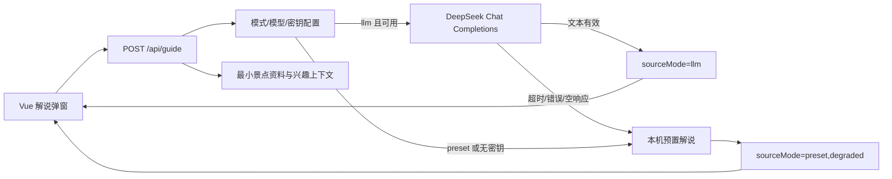

# 旅伴 AI 大模型解说试接入实施计划

版本：V1.0，2026 年 11 月 21 日。项目阶段 3：完成 WP5 中尚未接入的真实模型解说，并在本机进行一次可见试用。

## 1. 当前起点与前阶段结果

权威主计划为 [《旅伴 AI 功能演示 Demo 实现计划》V2.2](D:/pm/旅伴AI_MVP实现计划.md)。前一阶段的实际结果见 [《旅伴 AI Demo 实现与验收报告》](D:/pm/旅伴AI_Demo实现与验收报告.md)：前端、FastAPI、本机 JSON、规则推荐/排程/重规划和预置解说均已完成；API 契约已允许 `sourceMode=llm|preset`。没有任何真实模型请求已经通过的证据。

当前 `POST /api/guide` 将 `GUIDE_MODE=llm` 仅标记为降级，仍返回预置文本；当时的 `backend/run.ps1` 又固定覆盖为 preset。因此运行中的应用实际不调用模型。执行环境里发现 DeepSeek API 凭据变量可用，但凭据值不读取、不写文件、不输出，也不提交 Git。

## 2. 本阶段目标、边界与主计划关系

**目标：** 依据主计划 WP5/AC6，让景点解说可选择真实 DeepSeek API；用户能从当前页面看到模型生成内容。模型不可用时按原契约返回预置内容并明确标记。

**边界：** 只处理 `POST /api/guide`。推荐排序、路线排程、途中重规划、事实资料、反馈和持久化仍由现有规则/种子承担。保留默认 preset 与无密钥可运行能力。不引入 Agent、向量库、聊天历史、工具调用、自动上网、数据库、账号，也不开通服务或购买额度。使用现有可用凭据最多发起少量验证请求；不安装新的 Python 依赖，复用 `httpx`。

**主计划追踪：** V2.2 第 4 节的可配置解说 API、第 5.7 节的资料约束/备用文本、第 7 节 WP5、第 8 节 AC6；前阶段已满足接口和预置回退前置条件。本阶段使“模型生成成功”从计划占位变成可复现本机能力，并把配置交给后续运行者。

## 3. 用户场景与入口

贯穿示例：用户在「我的旅程」打开一处已选景点的解说，选择“简短”或“详细”。服务仅把该景点已有资料、来源标题、最强兴趣类别、解说深度和可用时间发给模型；页面展示生成文字和资料来源。若超时、拒绝、接口异常或响应为空，则显示预置解说和明确的回退说明。

真实入口：页面景点卡片/时间轴站点的「地点解说」入口 → `frontend/src/App.vue` → `POST /api/guide` → FastAPI → DeepSeek Chat Completions API 或既有预置回退。Operator 配置步骤与用户 UI 步骤在报告中分开。

## 4. 目标架构、数据流与技术选择

`guide.py` 封装模型调用和边界；`main.py` 负责接口校验、来源模式与回退响应；启动脚本默认 preset，但尊重显式传入的环境配置；`.env.example` 只列变量名和安全示例，不放真实密钥。网络访问使用官方 OpenAI 兼容接口，限制为单次非流式请求和短超时。

## 5. 模块实施与选择理由

| 模块 | 处理 | 原因 |
|---|---|---|
| `backend/app/guide.py` | 新增：构造严格资料边界提示词、发送受限请求、检查响应文本 | 解说是唯一需要生成式语言能力的环节；隔离网络和提示词，避免把模型混入路线规则 |
| `backend/app/main.py` | 修改：模式开关、返回真实来源标记；异常时预置回退 | 保持既有 API 返回形状与契约，前端不需新增接口 |
| `backend/run.ps1`、`.env.example`、本机 `backend/.env` | 修改：启动时加载被忽略的本机配置；示例模板列明环境变量 | 无凭据仍可正常启动，LLM 模式有明确且可复现的开关 |
| `frontend/src/App.vue` | 修改：发送前提示云端生成及发送字段，返回后标出 AI/预置模式 | 对用户说明何时会把有限上下文发送到第三方，以及结果并非核验后的旅游事实 |
| 主验收报告 | 更新现有报告第 10 节，记录实测成败及费用/范围边界 | 保持只有一份用户主报告 |

不修改接口契约字段，不发送完整画像、行程历史、精确位置或其他景点资料；不记录请求正文和密钥。模型只能整理所给材料，不能补造年代、人物、门票和开放信息。

## 6. 接口、数据、权限、失败与取消约定

- 输入沿用 `GuideRequest`：景点 ID、深度、可用分钟。上下文从该景点现有资料、来源标题和本机偏好取必要字段。
- 输出沿用 `Guide`：文本、现有来源列表、`sourceMode`、`degraded` 与 `notice`。LLM 成功为 `llm/false`；关闭、未配置或失败回退为 `preset/true`（主动 preset 模式仍用原契约展示预置来源）。
- 配置读取顺序：`LLM_API_KEY`，否则 `DEEPSEEK_API_KEY`；模式明确为 `llm` 才请求。默认 API 地址与模型只用于已识别的 DeepSeek 凭据；缺省仍可用 preset。
- 权限：仅后端使用密钥；密钥从不发往浏览器、不写本机项目文件、不记录日志。前端只收到生成正文与来源标记。
- 失败：超时、网络错误、非 2xx、JSON 无效、无候选、空白正文或过长正文均不让解说接口阻断；返回有效预置文本、`sourceMode=preset`、`degraded=true` 与中性中文说明。服务端只记安全错误类别，不记凭据、请求/响应正文。
- 取消：前端关闭弹窗时忽略迟到结果（现有 request-version 机制）；后端请求设定 20 秒上限，不写持久化状态。重试是用户再次打开/请求，最多验证一次成功路径和必要失败路径。

## 7. 工作包与依赖顺序

| 工作包 | 目的/场景 | 文件与步骤 | 验证和完成定义 |
|---|---|---|---|
| WP5.1 供应方配置 | 可控选择 preset/llm | 修改启动脚本与 `.env.example`；支持 DeepSeek 凭据环境变量；模式默认 preset | 未配置启动仍为 preset；密钥不写入项目 |
| WP5.2 生成与回退 | 景点解说调用模型 | 新增 `guide.py`，限时 HTTP 调用，严格资料提示，校验文本；在 `main.py` 接入并保留备用 | 使用 mock transport 证明成功/异常分支；接口契约仍通过 |
| WP5.3 用户可辨识性 | 看清生成模式和发送范围 | 解说入口发送前告知第三方处理字段；返回显示“AI 生成”或“预置回退” | 页面展示成功与回退来源；不修改其他功能 |
| WP5.4 本机实接 | 确认真实 API 往返 | 由 operator 在当前进程设置 LLM 模式，使用现存凭据；对一个景点发一次真实请求，核对返回与 fallback 备用路径 | 记录 HTTP 成功与模型名（不记录密钥/全文）；交代页面复现步骤和不可控事实边界 |

依赖：WP5.1 → WP5.2 → WP5.3 → WP5.4。不得用 mock transport 的成功代替真实供应商接受请求的证据。

## 8. 验收设计与通过条件

| 编号 | 场景 | 通过条件 |
|---|---|---|
| A1 | 默认/无密钥 | API 正常返回 preset 文本与预置来源，不进行外网调用 |
| A2 | 模型成功（mock） | `sourceMode=llm`、正文非空、来源保留、UI 显示 AI 来源提示 |
| A3 | 超时/HTTP 错误/空正文 | 接口返回预置解说、`degraded=true`，不泄露错误细节或密钥 |
| A4 | 资料边界 | 请求只带一个景点的允许资料与必要兴趣上下文；无线路线决策/写入 |
| A5 | 真实接入 | DeepSeek 返回成功响应；页面能显示真实生成文本并标为 AI 生成 |
| A6 | 代码与交付安全 | 契约和构建通过；真实密钥只从环境继承，`.env.local`/缓存不进入 Git |

模型输出的年代与旅游事实只能核对它是否被输入资料支持，不能把模型回答当官方事实。接受模型连通不代表地点资料完成事实审核。

## 9. 执行与变更控制

本阶段不新增服务、账号、订阅、收费额度或依赖。最多发起少量短输出试用请求；如果现有账号明确拒绝、无余额或需要新增充值，本阶段不继续产生费用，并保留 preset 回退。只在本机 loopback 调试服务，不公开端口。不得将密钥写入 Markdown、证据、源码、Shell 历史或 Git。任何偏离“仅景点解说、不给路线控制权”的提议需重新决策。

## 10. 交付与下一阶段衔接

计划交付：代码与配置、一个真实模型响应的脱敏验收证据、更新后的 [《旅伴 AI Demo 实现与验收报告》](D:/pm/旅伴AI_Demo实现与验收报告.md) 第 10 节，以及能在本机切换 preset/llm 的运行步骤。下一阶段仍可据此决定是否保留真实生成、替换供应商或继续默认 preset；模型仅做解说，不改变 Demo 核心业务确定性。

## 执行结果（2026-11-21）

- WP5.1—WP5.3 已实现：DeepSeek/OpenAI 兼容 API 的配置、独立解说调用、失败回退、发送范围提示均已接入；默认仍为 preset，密钥只从进程环境读取。
- A2（调用层 mock 成功）、A3（HTTP 503 回退信号）、无密钥配置、Qwen payload 和 Model Studio DeepSeek V4 payload 的 5 项专项测试通过；生产构建和 312 项契约结构检查通过。首次写成异步 pytest 用例时，因项目环境未安装 pytest-asyncio 而跳过；改为同步 HTTP 边界测试后通过。
- WP5.4/A5 最终**通过**：早期 DeepSeek 请求返回 HTTP 402、Qwen 请求返回 HTTP 403/`insufficient_quota`，均有保留的预置回退记录。用户更新配置后，Model Studio `deepseek-v4-pro-0813` 真实请求返回 `sourceMode=llm`、`degraded=false` 和非空解说，证明真实生成链路通过。旧失败记录保留，不覆盖。
- 默认端口 8031/5191 被占用，试用使用 8032/5192 和隔离数据目录。此前试用进程已停止；本次成功后重新启动同一隔离实例，目前保留运行供项目所有者从 `http://127.0.0.1:5192/` 查看。
- 全量既有后端回归曾在 `test_health_and_contract_shape` 停滞并被手动中断；本次通过的是 5 项解说专项测试，不把之前阶段 19 项结果冒充为本阶段全量复测。全量回归仍是一项未完成检查。
- 脱敏响应和运行日志保存在 `evidence/llm-trial/`。其中没有 API key；官方 402 说明见 [DeepSeek 中文错误码](https://api-docs.deepseek.com/zh-cn/quick_start/error_codes/)。

阶段状态：**真实模型解说已成功验收**。用户当前配置为阿里云 Model Studio `deepseek-v4-pro-0813`，一条真实短解说生成通过；推荐和路线仍由本机规则控制。历史失败调用与当前成功结果分别保存。全量后端回归停滞项、模型文本事实核查与浏览器视觉观察仍未完成。

### 配置交接补充（2026-11-21）

已新增本机私有配置文件 `backend/.env`；`backend/run.ps1` 通过 Uvicorn `--env-file` 自动加载它。`.gitignore` 已忽略 `.env`，真实密钥不会提交；`.env.example` 仍是无密钥模板。

### 用户配置后复试（2026-11-21）

用户已配置阿里云 Model Studio `qwen4-max`。按其官方接口要求，生成请求使用 `enable_thinking=true`，不发送 DeepSeek 专属 `thinking` 字段；对应 payload 单元测试通过。实接请求的业务接口返回 200，但供应商返回 HTTP 403 / `insufficient_quota`，因此仍没有 AI 正文。官方建议检查服务开通、模型/Key 权限和额度：[Model Studio 错误码](https://help.aliyun.com/zh/model-studio/error-code-start)。没有继续请求；隔离服务已停止，用户 `.env` 保留且仍被 Git 忽略。脱敏诊断见 `evidence/llm-trial/configured-model-diagnostic.txt`。

### 配置修正后成功调用（2026-11-21）

用户再次更新本机 `.env` 为 `deepseek-v4-pro-0813`。代码按 Model Studio DeepSeek V4 兼容方式发送顶层 `enable_thinking=false`，不发送 DeepSeek 直连 API 专用的 `thinking` 对象；5 项专项测试通过。真实 `/api/guide` 请求返回 `sourceMode=llm`、`degraded=false`，正文非空；前端首页 HTTP 200。脱敏响应见 `evidence/llm-trial/reconfigured-model-response.json`，专项测试输出见 `reconfigured-guide-tests.txt`。官方接口说明：[阿里云 DeepSeek API](https://help.aliyun.com/en/model-studio/deepseek-api)。

试用前端目前在 `http://127.0.0.1:5192/`，进入「我的旅程」后从景点卡片打开「地点解说」即可查看；后端使用隔离数据在 8032 端口运行，当前配置仍留在被 Git 忽略的本机 `.env`。模型生成内容仅基于现有景点资料，具体事实仍需独立核验。
