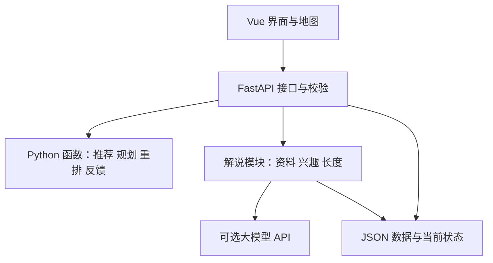

# 旅伴 AI 功能演示 Demo 实现计划

版本：V2.2，2026 年 11 月 18 日。已补齐冻结契约 1.0.0、Mock 样例和初始数据；Demo 范围不变。

本版根据项目所有者最新要求，将目标收缩为“功能都有、主流程可以连续演示”的本机 Demo。替代上一版完整 MVP 计划；[历史稿](D:/pm/旅伴AI_MVP实现计划_v1.0历史.md)仅供追溯，不再并行执行。实施范围与实际验收结果见同一主报告[《旅伴 AI Demo 实现与验收报告》第 10 节](D:/pm/旅伴AI_Demo实现与验收报告.md)。

## 1 项目简介与需求

旅伴 AI 帮助自由行游客填写偏好、获得景点推荐、安排旅行路线，在延误、疲劳、下雨和景点关闭后调整剩余行程，提供个性化景点解说，并通过反馈改变下一次推荐。

功能来源为项目说明书第 1.7—1.9 节；第二次作业补充业务规则，第三四次作业补充依赖关系。本次按用户最新授权缩减工程复杂度，保留业务功能。没有上一阶段实际实现报告可用于证明已有能力。

| 原项目功能 | Demo 最低实现 |
|---|---|
| 偏好分析 | 兴趣、预算、节奏、旅行时间表单，保存与修改 |
| 个性化推荐 | 标签加权排序，显示推荐理由 |
| 行程规划 | 景点顺序、到离时间、交通耗时，支持增删后重算 |
| 旅游地图 | 标记景点和顺序连接线，与时间轴一致 |
| 动态重规划 | 手动输入变化，保留完成节点，重算剩余部分，确认或放弃 |
| 自适应解说 | 按兴趣和简短/详细模式展示文字，资料有来源 |
| 兴趣推送 | 页面内附近推荐，显示距离、理由、耗时，可忽略或关闭 |
| 景点分类管理 | 简版列表，新增、修改、分类筛选 |
| 轻量反馈 | 喜欢/不喜欢、路线太累、解说太长，更新对应偏好 |

“功能都有”指按钮可以操作，数据与计算实际连通。可以用固定数据，但不能只切换预设截图代替推荐、规划和反馈更新。

## 2 范围与简化决定

| 上一版内容 | 本次处理 |
|---|---|
| 登录注册、用户隔离、管理员权限 | 删除，固定一个演示用户，管理页仅用于本机 |
| Vue、Spring Boot、FastAPI 三端 | 简化为 Vue 和 FastAPI 两端 |
| MySQL、Redis、数据迁移 | 删除，使用 JSON 文件 |
| 行程历史版本、并发控制、复杂事务 | 删除，只保留当前行程和一个候选 |
| 自动定位、天气监测 | 手动选择位置、点击状态变化按钮 |
| 真实交通与最短路算法 | 预置交通耗时矩阵，地图画顺序示意线 |
| 协同过滤、向量数据库、Agent | 删除，用普通 Python 函数和景点资料 |
| Docker、CI、云部署 | 不要求，本机启动即可 |

数据规模控制为一个城市或片区、约 12—15 个景点。当前实现按项目所有者后续要求，采用指定原型 HTML 默认香格里拉资料中的 14 个地点，覆盖历史、自然、美食、摄影及不同强度；门票、开放时间、坐标和交通耗时仍须出行前核验。默认一日游，安排约 3—4 个景点；为保留按日行程功能，简版支持两日分组，第二天继续安排剩余候选，不处理住宿和跨城。

预算只计算录入的门票等明确费用，不宣称覆盖全部旅行支出。只用一种固定出行方式。没有自动实时感知、系统消息推送、交易支付、社区、游记、语音、多语言和开放域聊天。

Spring Boot、MySQL 等原草案技术在本版暂缓。如果课程硬性要求这些技术，需要另行核对；本版依据用户最新的 Demo 优先要求编制。作业或答辩应同步实际范围，不沿用旧计划声称已实现全部工程能力。

## 3 核心场景与闭环

演示用户喜欢历史文化、偏好轻松节奏，计划 09:00—17:00 游玩。

1. 填写偏好，推荐博物馆、历史街区等，显示理由。
2. 生成 A 博物馆→B 街区→C 公园，展示时间轴和地图。
3. 点击完成 A，系统记录已完成。
4. 点击“延误 40 分钟”或“有点累”，重新排后续，把放不下或强度过高的 C 移除或替换为 D。
5. 展示原因和新时间，确认后生效；放弃则原行程不变。
6. 到达 D，查看按历史兴趣组织的简短/详细解说。
7. 查看附近推荐，演示忽略和关闭。
8. 提交喜欢展馆、希望少走路的反馈，再次推荐时看到影响。

A—D 为流程代号，实际使用原型 HTML 的香格里拉景点种子。交通耗时标明为路线规划估算，不代表导航或实时路况。


核心保留三条规则：偏好真实参与计算；已完成节点不被重排覆盖；反馈真实进入下一次推荐。

## 4 技术栈与架构

| 层次 | 技术 | 负责内容 |
|---|---|---|
| 界面 | Vue 3、Vite、Element Plus | 表单、推荐列表、时间轴、弹窗；普通响应式状态即可 |
| 地图 | Leaflet 与一家底图服务 | 景点标记和顺序连接；接入时核对使用条件与署名 |
| 后端 | Python、FastAPI、Pydantic | 统一接口、输入校验、所有业务计算 |
| 存储 | JSON | 景点、交通耗时、单用户状态 |
| 解说 | 一家可配置 LLM API，备用预置文本 | 基于景点资料按兴趣和长度组织文字 |
| 运行 | Node 项目依赖、项目专属 Conda 环境 | 两个本机服务 |



**界面层：**负责填写和展示。推荐、行程、地图、状态变化、解说和反馈集中在旅行工作台。地图和时间轴读取同一份后端行程，刷新后重新读取状态。

**接口层：**调用函数并保存结果。只做必填、类型和基本业务校验，错误返回中文提示。没有鉴权，服务只绑定本机地址，不公开部署。

**规则层：**普通 Python 函数，先过滤再排序，累计时间排程。大模型不决定开放时间、预算和路线是否可行。

**解说层：**按景点 ID 直接取资料，拼入兴趣和长度要求，无需向量检索。模型失败时返回对应兴趣的预置内容，并标注“预置解说”；无资料则说明不足。

**文件层：**景点种子、交通矩阵、当前状态三个文件即可。单进程使用进程内锁、临时文件写入后替换，避免普通重复操作损坏文件；不做多进程并发。坏文件保留并提示重置，不静默覆盖。

## 5 页面与模块实现

### 5.1 三个页面

| 页面 | 内容 |
|---|---|
| 偏好与旅行设置 | 兴趣、预算、节奏、日期、每日起止时间、天数 |
| 旅行工作台 | 推荐、地图、时间轴、完成、变化、候选确认、解说、附近和反馈 |
| 景点管理 | 表格、分类筛选、新增与编辑弹窗 |

不制作个人中心、运营仪表盘或复杂设置。

### 5.2 景点与资料

建议 `storage.py` 读写，景点管理页编辑。字段包括 ID、名称、分类、标签、坐标、单个开放区间、费用、停留分钟、室内外、强度、资料和来源。无需复杂节假日日历，关闭通过事件演示。

新增修改校验名称、坐标、时间和非负费用；不完整记录不参与规划。停用代替物理删除。验收：新增、修改、筛选、错误输入和重置均有效。

### 5.3 偏好

建议 `preferences.py`。兴趣用 0—1 权重，问卷勾选映射初值；节奏只有轻松和正常。保存后可查看修改，反馈更新同一对象。

今天疲劳只影响当前旅行，明确选择“以后少走路”才改变默认节奏。非法输入不覆盖原值。验收：修改、刷新恢复、不同兴趣推荐变化。

### 5.4 推荐

建议 `recommend.py`，函数 `recommend(profile, attractions, conditions)`。排除关闭、明显超预算等候选，按标签匹配求分，对轻松用户的高强度景点减分；相同分数按 ID 排序。

理由从规则生成，例如“匹配历史兴趣，室内，约需 60 分钟”。无需模型生成理由。无候选显示条件冲突。验收：同一输入稳定，历史与自然画像在固定样例中排序不同。

### 5.5 规划与地图

建议 `planner.py`、`TripTimeline.vue`、`TripMap.vue`。按推荐顺序尝试景点，每次累计交通、等待和停留时间，完整游览落在开放区间内、当天时间及预算允许才加入。无解说明原因。

两日模式在第二天继续安排剩余候选，避免重复并累计费用；不求全局最优。用户添加或移除后重新排程，失败保留原结果。地图只画坐标和顺序线，标注“示意路线，耗时为演示估计”，不冒充导航；底图失败显示本地坐标示意图。

验收：时间包含移动，开放时间和预算满足，地图与时间轴一致，一日和两日各演示一次。

### 5.6 执行与重规划

建议 `replan.py`。状态只需未开始、当前、已完成、已跳过。到达或完成由手动按钮记录，重排从确认的当前时间和位置开始。

| 变化入口 | 简单有效的处理 |
|---|---|
| 延误 | 增加当前时间，重算剩余，移除放不下的节点 |
| 疲劳 | 降低剩余数量或排除高强度点，尝试近处低强度替代 |
| 下雨 | 排除受影响室外候选，尝试室内替代 |
| 关闭 | 排除指定未完成景点，尝试替代 |
| 临时兴趣 | 本次调整标签权重，重排剩余 |

必须复用规划时间校验，不能只换景点名称。返回一个候选和简短差异；确认后替换未来部分，放弃不变。已完成记录原样保留。当前位置正在游览时，先让用户确认完成或离开，再计算后续，避免隐式改写状态。

新的状态操作会清除旧候选，无需版本系统。重复完成不增加记录，重复确认不重复应用。无可行新路线时保留原状态，提示结束或放宽条件。验收：四类核心变化、无解、确认和放弃。

### 5.7 自适应解说

建议 `guide.py`。输入景点、兴趣、简短/详细和可用时间，读取该景点资料后调用模型；显示正文和来源。简短详细长度明显不同，兴趣不同重点不同。

资料中的文字仅作为知识，不作为操作指令。模型失败返回备用文本并说明来源。无需会话系统，单次景点追问可选，不作为必需功能。验收：两种模式、兴趣差异、事实核对及无密钥备用路径。

### 5.8 附近兴趣推荐

复用推荐函数，根据当前位置算直线距离，筛选范围内当前开放景点，展示前 2—3 个及理由和耗时；距离标为直线距离。手动刷新或到达时刷新，不做后台通知。

忽略在本次旅行内隐藏该项，关闭保存开关；加入行程时继续进行时间校验。验收：附近结果、忽略、关闭和加入冲突。

### 5.9 反馈

建议 `feedback.py`。喜欢/不喜欢使对应兴趣增加/减少固定小步长，限制在 0—1；路线太累可确认改为轻松；解说太长把默认深度改为简短。表单明确展示要更新什么，提交即确认。

每次提交携带请求 ID，已处理 ID 不再重复应用。展示前后变化，重新推荐验证效果。解说差评不能错误降低景点兴趣。不做自动训练或复杂长期记忆。

## 6 数据、接口与恢复

建议目录均为待创建路径：

```text
backend/app/
  main.py  schemas.py  storage.py  preferences.py
  recommend.py  planner.py  replan.py  guide.py  feedback.py
backend/data/
  attractions.seed.json
  travel_times.json
  demo_state.json
frontend/src/
  pages/
  components/
```

状态保存修改后景点、画像、当前行程、一个候选、反馈及推荐开关。刷新和重启恢复已保存内容，不保留多版本历史。重置前显示确认，恢复种子状态，不删除原始资料。

| 接口 | 用途 |
|---|---|
| GET `/api/state` | 读取状态 |
| PUT `/api/profile` | 保存偏好与条件 |
| GET/POST/PUT `/api/attractions` | 查询、新增、修改；修改携带 ID |
| POST `/api/recommend` | 推荐 |
| POST `/api/plan` | 初始生成或编辑后重算 |
| POST `/api/trip/status` | 到达、完成、跳过 |
| POST `/api/replan` | 生成候选 |
| POST `/api/replan/confirm`、`/api/replan/discard` | 确认或放弃指定候选 |
| POST `/api/guide` | 解说 |
| POST `/api/nearby` | 查询、忽略与开关 |
| POST `/api/feedback` | 反馈更新 |
| POST `/api/reset` | 确认后重置 |

错误用中文 `message` 和必要详情即可。请求中禁用重复提交，写失败提示未保存且保留原文件。模型设超时；取消等待不改变行程。不做任务队列和复杂错误码体系。

## 7 工作包与开发顺序

每步先做到可操作再继续，不按具体日期排期。

| 工作包 | 对应需求与依赖 | 实现和完成条件 |
|---|---|---|
| WP1 数据与骨架 | 景点管理；无前置 | 三页、种子、状态读写；增改查可用，错误不保存，重置和恢复有效 |
| WP2 偏好到推荐 | 偏好推荐；依赖 WP1 | 表单、权重、排序和理由；换兴趣出现预期差异 |
| WP3 推荐到行程 | 规划地图；依赖 WP2 | 时间和预算计算、地图、增删、两日分组；冲突不覆盖原行程 |
| WP4 执行到调整 | 重规划；依赖 WP3 | 完成、事件、候选、确认放弃；四类变化有效，历史保留 |
| WP5 解说 | 解说；依赖资料与偏好 | 模型、长度和兴趣、预置备用；事实核对与失败路径通过 |
| WP6 附近与反馈 | 兴趣推送、反馈；依赖 WP3/WP5 | 附近、开关、反馈去重和更新；再次推荐证明闭环 |
| WP7 连续演示 | 全部；依赖 WP4—6 | 固定脚本、修阻断问题、补启动和验收说明；完整主线一次走完 |

工作包表示业务依赖，不要求 A 等待 B 完成对应接口后才制作页面。两人采用下述分工，A 使用同格式的固定样例独立开发界面，B 独立验证接口与计算，最后集中接入真实服务。

### 7.1 二人职责与交付边界

采用“A 负责前端、景点资料和演示；B 负责后端、全部计算和存储”的方式。不要按“各自做几个完整功能”切分，否则推荐、规划、重规划和反馈会由不同人修改同一套规则，增加沟通。A、B 为职责代号，姓名由团队自行对应。

| 人员 | 主责 | 不在本人的实现范围 | 必须交付 |
|---|---|---|---|
| A：界面、数据与演示 | 全部页面、组件、地图、请求封装；景点和知识资料整理；界面走查与演示脚本 | 不在前端重复计算评分、时间排程、反馈权重；不修改后端存储逻辑 | 三个可操作页面、Mock 模式、真实接口模式、12—15 个景点资料、前端启动方式、演示步骤与界面证据 |
| B：后端、规则与集成 | FastAPI、接口契约、Mock 样例、JSON 存储、推荐、规划、重规划、模型接入、附近推荐、反馈；最终技术合并 | 不另建页面；不要求 A 用人工拼字段补救接口偏差 | 符合契约的接口、固定交通矩阵、演示初始化与重置、后端启动方式、规则检查结果、真实接口记录 |

需求取舍和最终验收由两人共同承担。A 对场景是否看得懂、操作是否连贯负责，B 对计算和状态是否正确负责。这里只保留 Demo 所需职责，不恢复原五角色组织成本。

### 7.2 文件归属与修改规则

以下为待创建的代码路径，独立开发期间尽量各自修改自己的文件。

| 文件或目录 | 主责 | 交接方式 |
|---|---|---|
| `frontend/src/pages/`、`components/`、样式及前端配置 | A | B 不直接重写页面；需要显示新内容时按契约交付 |
| `frontend/src/api.js` | A | 所有页面统一通过这里调用；切换 Mock/真实接口只改配置 |
| `backend/app/`、后端依赖与配置 | B | A 通过 API 使用，不直接读写后端状态文件 |
| `backend/data/attractions.seed.json` | A 整理，B 定义格式并校验 | B 先提供完整样例；A 一次性交付首批，再补缺，不随意改景点 ID |
| `backend/data/travel_times.json` | B | 使用 A 确定的景点 ID；缺失路段由 B 补全并检查 |
| `backend/data/demo_state.json` | B 管理的运行产物 | 不作为两人手工编辑和互传的数据源，不提交模型密钥 |
| `contracts/api-v1.json`、`contracts/mock/*.json` | B | 存放约定和样例，A 直接复用；路径为建议，不建设额外文档体系 |
| 本主计划与最终实现验收报告 | A 维护，B 补充技术内容并复核 | 直接更新同一份文件，不各写一份重复报告 |

如使用 Git，A 在前端分支开发，B 在后端分支开发；B 负责最终合并，A 检查页面。无需复杂分支制度。共同文件修改前留一条简短记录即可，不要求每次开会。

### 7.3 开始前一次性固定的约定

契约 1.0.0 和完整样例已按第 11 节固定，A、B 可直接使用，无需再召开字段设计会。B 按契约实现接口，A 按相同样例开发页面。只有实际发现矛盾或范围变化才提出具体修订，不需要每实现一个按钮就一起联调。

| 约定 | 固定内容 |
|---|---|
| 范围与主线 | 本计划的三页、功能表、固定演示顺序；不临时增加登录、数据库等 |
| 景点 | ID 为字符串且稳定；坐标为数值；费用为元；时长为分钟；标签使用同一枚举 |
| 偏好与条件 | 兴趣权重、节奏、预算、日期、天数、每日开始和结束时间分属哪些字段 |
| 行程 | 节点 ID、景点 ID、所属天、预计到离时间、交通分钟、停留分钟、状态；地图直接读取该节点数组 |
| 时间 | 日期用 `YYYY-MM-DD`，计划时刻用带日期的 ISO 8601 字符串和 `+08:00` 时区；不传“上午九点”等自然语言时间 |
| 状态与事件 | 状态固定 `pending/current/completed/skipped`；事件固定 `delay/fatigue/rain/closed/interest_change`，界面展示中文 |
| 候选与反馈 | 候选 ID、节点列表、差异理由；反馈对象、类型、请求 ID、更新前后值 |
| 返回与错误 | 成功统一 `{ "data": ... }`；失败使用非成功 HTTP 状态及 `{ "message": "中文原因", "details": ... }`；空数组与无候选也提供样例 |
| 启动与连接 | 约定前后端本机端口、API 地址配置、跨域允许地址；模型密钥只由后端读取 |

第 6 节每种操作的请求与响应均已在 `contracts/mock/` 提供；放弃候选固定为 POST `/api/replan/discard`。`api-v1.json` 已采用 OpenAPI 3.1 格式，由 B 按既定结构实现并核对；不另做庞大接口平台。

样例不仅给成功结果，还应包括无推荐、无可行行程、候选已失效、模型备用内容、保存失败。Mock 指与真实接口格式相同的固定数据，只用于 A 开发页面；它不证明后端计算已经正确。

### 7.4 A 的独立实施清单

1. 建立三个页面和通用加载、空结果、错误提示；统一从 `api.js` 调用，不在组件中散落请求地址。
2. 按 B 的示例准备 Mock 适配：相同函数签名、相同返回格式，用于展示推荐、初始行程、变化候选、解说和反馈结果。用环境配置选择 Mock 或真实服务。
3. 实现偏好填写、推荐理由、时间轴、地图和增删节点操作。地图不另算顺序，表单不自行决定可行性。
4. 实现完成、变化录入、候选对比、确认与放弃。等待请求时禁用重复提交，后端错误原样转为友好提示。
5. 实现两种解说深度、来源与备用标记、附近忽略关闭、反馈前后值展示、景点管理。
6. 按冻结格式整理 12—15 个景点：名称、坐标、类别、室内外、强度、开放时间、费用、时长、资料与来源；保证有室内替代和低强度替代。
7. 用 Mock 完整走一次主线，检查每个操作都有可见反馈，向 B 交付前端、景点数据和待修问题清单。

A 完成条件：没有后端运行时也能验证所有页面和状态展示；一处配置可以切到真实接口；所有必需字段取自契约；景点数据交付完整。Mock 对按钮的模拟效果明确标识，不作为最终验收证据。

### 7.5 B 的独立实施清单

1. 先交付字段契约、一个完整景点样例及每种请求响应，建立 FastAPI 工程和专属 Conda 环境。
2. 完成文件初始化、读写和重置；校验 A 的景点数据，按稳定 ID 补齐交通耗时。
3. 实现偏好保存、推荐过滤和评分、理由生成；用接口请求直接比较两种兴趣。
4. 实现一日与两日排程、增删后重算、预算和开放时间检查，用固定输入自行验证。
5. 实现执行状态、五种事件和剩余重排，验证四类核心变化；完成记录不变，放弃不修改正式行程，新状态操作清除旧候选。
6. 实现解说生成与备用路径、附近筛选和开关、反馈去重与更新；不依赖 A 的页面才能测试。
7. 输出接口结果与关键规则检查记录，确认真实返回与契约一致，再提交可供集中合并的版本。

B 完成条件：接口工具或脚本可以跑完主线；没有前端也能验证数据保存与计算；所有返回遵守约定，错误路径可复现；无密钥也能完成备用解说演示。

### 7.6 工作包如何落到两个人

| 工作包 | A 的产出 | B 的产出 | 集中合并时检查 |
|---|---|---|---|
| WP1 | 页面骨架、景点原始资料、管理界面 | 数据格式、存储、校验、管理接口和重置 | 资料可导入，增改查与恢复有效 |
| WP2 | 偏好表单、推荐卡片和理由展示 | 画像保存、推荐规则和接口 | 表单实际影响推荐 |
| WP3 | 地图、时间轴、增删与两日展示 | 时间预算计算、一日两日排程 | 同一份结果驱动地图与时间轴 |
| WP4 | 状态按钮、事件表单、差异与确认界面 | 状态与候选保存、重排、确认放弃 | 完成记录不变，候选实际生效 |
| WP5 | 解说抽屉、模式和来源展示 | 模型、资料组织、备用内容 | 不同模式和失败来源清楚 |
| WP6 | 附近卡片、开关、反馈与前后值 | 附近规则、去重、权重更新 | 反馈进入下一次推荐 |
| WP7 | 主导演示操作、记录界面问题和证据 | 合并代码、启动服务、处理技术问题 | AC1—AC10 连续验收 |

### 7.7 减少反复确认的规则

- 契约确认后，字段名称、类型、单位、枚举和业务含义不随意变化。两人自己负责内部实现，不为普通组件或函数细节反复征求意见。
- 缺少展示信息时优先增加可选字段并提供默认值；不得静默改名或把数字改成字符串。新增可选字段也更新契约和样例，让另一方可以自行同步。
- 如果必须破坏原契约，提出人一次写明“旧字段、新字段、原因、影响页面/接口、迁移办法”，集中处理；不能让另一方猜测。
- 普通问题记录在一份简短清单中，写清复现、预期、实际、负责人；不逐个暂停对方开发。只有阻断全部开发、改变范围或导致契约无法使用的问题立即沟通。
- A 不直接修后端规则，B 不直接改前端交互；必要交叉修改先说明文件，避免同时编辑。
- 景点 ID 首批固定后不改；资料补充保持格式兼容。B 可以先用少量符合格式的数据开发，不等待 A 整理完全部资料。

### 7.8 最终集中合并与验收

目标是“开头定契约，开发中各自验证，最后一轮集中合并并修复”，而不是保证任何情况下都无需返工。最终真实接口验收不能省略，也不能用 Mock 演示替代。

集中合并前，A 检查 Mock 主线及数据完整性；B 检查真实接口主线及契约一致性。条件具备后按以下顺序进行：

1. B 合并前后端代码，载入最终样例，启动后端；A 切换 `api.js` 到真实模式，核对连接地址。
2. 先验证读取状态、保存偏好和推荐，再验证规划、地图和完成节点，避免前置失败影响后续判断。
3. 连续执行变化、候选、放弃、确认、解说、附近与反馈，检查页面和实际保存结果。
4. 按第 8 节检查四类变化、一日两日、无解、备用解说、刷新重启和重置。
5. A 修页面/交互问题，B 修接口/计算/保存问题。字段偏离由偏离契约的一方修改，不临时在两端各补一套转换掩盖问题。
6. 修复后重跑受影响项；涉及共享状态或流程时重新跑完整主线。全部必要项通过后冻结演示数据和配置。

A 走查 B 的规则结果和资料事实，B 走查 A 的界面操作；这属于交叉复核，并非独立第三方验收。最终报告如实区分各自自测与对方复核。

### 7.9 两人最终交付清单

| 人员 | 最后交给对方的内容 |
|---|---|
| A → B | 可启动前端、Mock/真实切换配置、景点种子资料、页面问题清单、演示脚本和界面证据 |
| B → A | 可启动后端、项目环境和依赖说明、实际 API 地址、契约与样例、固定交通数据、初始化重置方法、计算与接口证据 |
| 共同 | AC1—AC10 结果、未完成或已知限制、唯一实现验收报告；不另建两套重叠文档 |

## 8 验收与证据

| 编号 | 通过标准 |
|---|---|
| AC1 | 偏好可保存修改，刷新仍在，不同兴趣影响推荐 |
| AC2 | 景点新增修改筛选有效，错误数据被拒绝 |
| AC3 | 一日与两日均有顺序、到离时间、交通耗时，满足固定样例开放时间和预算 |
| AC4 | 地图顺序与时间轴一致，示意和估计来源说明清楚 |
| AC5 | 延误、疲劳、下雨、关闭各有有效样例；历史不变，确认放弃有效，无解有提示 |
| AC6 | 解说长短和兴趣差异可见，关键事实可核对，失败有标明的备用内容 |
| AC7 | 附近有距离、理由、耗时，忽略和关闭有效 |
| AC8 | 反馈改变正确字段，重复不加权，再次推荐可观察效果 |
| AC9 | 刷新与重启恢复，重置后能重新演示 |
| AC10 | 偏好→推荐→规划→变化→调整→解说→反馈→再次推荐连续完成，无阻断 |

优先手动走查，不建庞大测试体系。为评分、时间约束、完成节点保留、反馈去重做少量自动检查。其他成员走查与开发者自测分别记录，AI 事实由人工核对。固定数据和在线模型分别标明，不把预置文本说成实时生成。

## 9 本机启动与动手演示

项目按所有者要求使用独立 Conda 环境 `D:\miniconda3\envs\pm`，执行时设置 `PYTHONNOUSERSITE=1`，不读取用户级 Python 包。前端依赖由 `frontend/package-lock.json` 固定。默认只运行预置解说，不连接真实模型。

先检查 `127.0.0.1:8031` 和 `127.0.0.1:5191` 都空闲。在两个 PowerShell 终端分别执行：

```powershell
# 终端一：后端
& 'D:\pm\backend\run.ps1'

# 终端二：首次运行先 npm ci，之后直接运行 npm run dev
Set-Location D:\pm\frontend
npm run dev
```

打开 `http://127.0.0.1:5191`。首次使用且依赖尚未安装时，先运行 `npm ci`。若初始日期已过，先到“旅行偏好”换成合适日期；日期、天数与门票预算在行程建立后锁定，恢复初始资料后可重新填写。

验收命令：`$env:PYTHONNOUSERSITE='1'; & 'D:\miniconda3\envs\pm\python.exe' -m pytest backend\tests -q`、`npm run build`、`node contracts/validate.mjs`。界面步骤：填写历史兴趣、轻松节奏、09:00—17:00；查看推荐和理由，增删景点并规划；记录到达和完成；分别演示延误、疲劳、下雨和关闭，查看候选路线后确认或放弃；展示解说与附近开关；提交喜欢/不喜欢及节奏反馈，再次推荐。重置后另演示两日行程。

## 10 执行规则与交付

在 Demo 范围内自主采用简单实现，不额外开发权限、数据库、并发、云部署。付费接入或公开部署前先明确成本和变更，计划中的技术选择不代表购买授权。

保留失败与未完成记录，修复后复查对应场景，不以降低标准掩盖问题。实际限制、验收覆盖及端口检查结果记录在唯一实现与验收报告中。

交付为源代码、样例数据、依赖与启动配置、本计划，以及一份《旅伴 AI Demo 实现与验收报告》。完成后在该报告解释实际能力、入口、架构、关键代码、运行教程、验收和局限；截图日志作支持证据，不再另建重复说明。后续生产化不属于本阶段。

## 11 已固定的开发契约 1.0.0

本节与机器可读文件共同组成实现基线。字段名、类型、必填项以 [api-v1.json](D:/pm/contracts/api-v1.json) 为准；业务语义以本节为准。发现冲突先记录并修正基线，不让前后端各自解释。当前业务服务按本契约实现，验收明细见主报告。

### 11.1 立即可用的文件

| 文件 | 用法 |
|---|---|
| [api-v1.json](D:/pm/contracts/api-v1.json) | 16 个 HTTP 操作，33 个数据结构，包含所有字段、必填、枚举、错误和请求返回类型 |
| [Mock 索引](D:/pm/contracts/mock/index.json) | 查找 35 个请求/响应场景；每文件的 `response` 才是 HTTP body，不能把整个文件交给页面 |
| [景点种子](D:/pm/contracts/attractions.seed.json) | 当前香格里拉 14 个原型景点，稳定 ID 为 a01—a14 |
| [交通矩阵](D:/pm/contracts/travel_times.json) | start 和 14 个地点的完整双向分钟矩阵，来自原型固定估算并转成契约格式 |
| [初始状态](D:/pm/contracts/demo_state.seed.json) | profile、conditions、runtime、空行程、空候选、反馈和开关的初值 |
| [运行配置](D:/pm/contracts/runtime-config.json) | 固定端口、前端模式、模型占位和规则参数 |
| [检查脚本](D:/pm/contracts/validate.mjs) | 使用 Node 运行 `node contracts/validate.mjs`，复查结构、引用和数据一致性；不安装依赖 |

当前运行区域固定为香格里拉，景点资料取自项目所有者指定的原型 HTML。原型没有给出外部核验来源，部分地点为体验空间/主题点，门票、开放时间、坐标及交通耗时不保证准确；界面要求出行前复核，不把这些字段当作已核验的旅行指南。若后续切换其他原型目的地，须建立城市隔离和对应矩阵，不可把不同城市地点混合排程。

### 11.2 公共格式与接口使用

- 后端 `http://127.0.0.1:8031`，前端 `http://127.0.0.1:5191`；Vite 固定端口，已占用时报错，不自动跳到另一端口。
- 允许来源包含 `http://127.0.0.1:5191` 与 `http://localhost:5191`（兼容旧配置的 5173 来源）；无 Cookie、无登录凭证。所有接口是本机单用户用途。
- JSON 使用 UTF-8、camelCase 字段；ID 为不透明字符串；经纬度按 `point.lat`、`point.lng` 使用，不使用含义不明确的双元素数组。
- 金额是人民币元，保留至两位小数；时长和距离分别是整数分钟、整数米；时刻是带 `+08:00` 的完整日期时间。起止时刻不能跨午夜，`dayStart < dayEnd`。
- 成功统一 HTTP 200 和 `{data: ...}`，不使用 204。参数错误 400，不存在 404，状态冲突 409，规划无解 422，保存/内部失败 500。FastAPI 默认输入校验错误需转换为约定的 400，避免和业务无解 422 混淆。
- 错误统一 `{message: string, details: object}`，无详细内容时 `details: {}`。无推荐是 200、`items: []`、有文字 `emptyReason`，不是异常；无可行路线才是 422。
- 输入未知字段拒绝；前端读取输出时容忍未来新增可选字段，不依赖对象属性顺序。空业务对象显式 `null`，集合始终为数组，不用空字符串代替。
- 无请求体的 GET 或推荐 POST 不要求发送 `{}`。所有变更操作均用 JSON body。服务端生成 a13 等新增景点 ID、行程 ID 和候选 ID，前端不根据格式拆解 ID。
- 前端通过 `api.js` 统一解包 `data`。写操作成功后以服务端返回状态替换界面快照，不在页面再计算一遍。接口清单和精确返回类型见 OpenAPI。

### 11.3 偏好 推荐与排程规则

兴趣固定 history、nature、food，权重均为 0—1；分类同名，但景点可有多个兴趣标签，不允许重复标签。节奏 relaxed/normal，解说 short/detailed。原始画像与本次临时兴趣分开使用。

推荐分数固定为景点标签对应兴趣权重的平均值；relaxed 或本次 fatigued 时，高强度景点减 0.25，分数最低 0。有效候选按分数降序，再按 ID 升序。分数保留四位小数，理由由命中规则生成。过滤 disabled、已关闭、票价大于剩余预算、完整开放区间不足以容纳停留的地点；组合时间由排程继续检查。

`POST /api/recommend` 使用已保存偏好与条件，返回候选但不改行程。`POST /api/plan` 的 `attractionIds: []` 表示自动按推荐顺序安排；非空数组表示用户给定的尝试顺序，禁止重复和未知 ID，不再暗中按分数重排。每日至多 4 点。`mode: generate` 新建当前行程并清空旧执行记录、候选、临时状态和附近忽略；保留画像、反馈历史、景点修改和开关。页面在已有行程时先提示用户将替换当前行程。

初始排程从每日 dayStart 和 startPoint 开始，无返程要求；每次按矩阵加交通，再等待开放，计算完整游览结束。无法放入当前日则尝试下一日，仍不可行则跳过并在 warnings 说明。至少放入一个景点才保存，否则 422 保留原状态。两日共享预算，同一景点不重复。只计算门票，不计算交通票价或餐饮住宿。开始节点同样计算 start 到景点的耗时。

`mode: edit` 只允许尚无 current/completed/skipped 节点时使用，保留 trip.id，重新排程；旅行执行后调整统一走重规划，避免编辑覆盖历史。`PUT /api/profile` 更新画像/条件但不自动改行程，并清除候选；已有行程时 conditions 不允许改变，需先明确重置或新建旅行设置。单独修改画像仍允许。资料更新同样清除候选，旧行程中保存的名称、时间和费用快照不回写。

无行程时保存 conditions 同步 runtime 到 startDate + dayStart 和 startPoint，并清空临时天气、疲劳和关闭列表。日期不锁定为样例的 2026-11-18，实际生成时按用户条件计算。附近和重排从不读取电脑当前时间，避免第二天演示时样例自动过期。景点与矩阵相同 ID 路段优先查矩阵；手动位置不等于矩阵节点时，演示交通固定按 15 分钟估计，同坐标为 0，并继续标注估计来源。新增景点由 B 自动补齐与现有点的对称 15 分钟矩阵，不要求 A 同时手工改两个文件。

### 11.4 状态 候选和事件的精确行为

- pending → current 对应 arrive；current → completed 对应 complete；pending → skipped 对应 skip；current → skipped 对应 leave。leave 保留实际到达时间并记录实际离开时间于 actualFinishedAt，状态仍标 skipped，不冒充 completed。
- 同一时刻至多一个 current；at 不能早于 runtime.now，完成不能早于实际到达；终态不能普通回退。相同终态操作重复提交原时间则返回当前结果，改变时间或非法转移返回 409。
- 到达、完成、离开更新 runtime.now 与 point；跳过未来节点不移动位置，更新 runtime.now。任何成功状态操作清除候选。实际时间不覆盖原预计时间。
- 重规划要求已有行程且无 current 节点；用户先完成或离开当前点。请求 now 不早于 runtime.now，point 是用户确认位置。
- events 包含 1—5 个不同类型事件，重复类型返回 400；delay.minutes 1—240，fatigue/rain 不再附等级；closed 一次指定一个未完成景点；interest_change 指定一个标签。
- 计算起点为请求 now 加 delay 分钟，前端提交的是延误前的确认时刻，不提前再加一遍。fatigue 本次排除 high 强度；rain 本次只选 indoor；closed 排除指定点；interest_change 本次对应权重加 0.3、上限 1，不保存为长期画像。
- 已确认临时状态中的 rain/fatigued/closed 在本次旅行持续有效，新事件在其基础上合并。相同关闭点不重复添加。
- 已完成和已跳过节点原样保留，其节点 ID 不变；已到达地点即便后续离开也按已发生门票计入，pending 被删除不计票。剩余候选可包含新景点，但排除历史已访问和跳过点，未受排除条件影响的原剩余点先尝试，再补推荐候选。
- 以当前日期的剩余时间起排；必要时按原天数排到下一日，不回写过去日期，不延长 dayEnd。不要求每次事件都一定替换景点：保留合理路线并更新时间或给出无需改变的理由也是合法结果。
- /replan 只保存一个 proposal，不修改正式 trip/runtime。proposal.runtimeAfter 是确认后将采用的状态。/confirm 一次采用 proposal.trip 和 runtimeAfter，清空候选；/discard 只清空候选，不采用临时状态。
- 每次生成候选分配新 ID，成功后替代旧候选。无解返回 422，同时清除旧候选，保留正式 trip/runtime，防止旧建议继续被确认。候选被清除后确认返回 409。
- 相同 proposalId 已成功确认时，立即重复确认返回当前状态；服务只需保存最后一次确认 ID，无需版本库。若之后发生其他状态修改或新规划，旧 ID 返回 409。重复放弃当前已放弃 ID 可返回当前状态，其他 ID 返回 409。

### 11.5 解说 附近与反馈

解说按最高兴趣选择重点，并列按 history、nature、food 顺序。availableMinutes ≤ 2 时 effectiveDepth 固定 short，否则按请求 depth。模型输出简短目标约 80—150 字，详细约 250—400 字；这是生成目标，不以字符数机械判定正确。优先资料事实，禁止补造年代等信息。preset 模式从 presetGuides 选对应兴趣和 effectiveDepth。GUIDE_MODE=preset 为默认，llm 接入失败也返回 200、sourceMode=preset、degraded=true 和 notice；用户主动选用预置模式也必须显示来源。

nearby action=query/ignore/set_enabled；半径固定 3000 米、最多 3 项，用 Haversine 直线距离，米数四舍五入。过滤停用、关闭、历史已访问/跳过、当前正式行程已有及本次忽略景点；rain 时排除室外、fatigued 时排除高强度；以 runtime.now 检查交通估计加完整停留可在开放与当日结束前完成。兴趣分降序、距离升序、ID 升序。estimatedMinutes 为交通估计加停留，不等于直线步行分钟。nearbyEnabled=false 时 items=[]，保留忽略列表；ignore 和开关不改行程，也不清除候选。

反馈 like/dislike 必须指定景点，对其全部标签各加/减 0.1，限制 0—1、保留两位小数；too_tiring 改 pace=relaxed；too_long 改 guideDepth=short。后两种不提交 attractionId。提交即用户明确确认，无需增加另一套确认流程。记录 before/after，不以反馈生成自动训练。

requestId 由前端每次新反馈生成，失败重试沿用原 ID。相同 ID、相同请求返回原 record、duplicate=true 及最新 state，不重新应用；相同 ID、不同内容返回 409。反馈更新成功清除候选，不回写已确认行程。响应可为“已是轻松模式，数值未变”，不制造虚假变化。

重置必须提交 `{confirm: "RESET_DEMO"}`，恢复全部演示初值，包括景点、反馈、忽略、候选及确认 ID；接口执行前页面提示会清除演示状态。

### 11.6 A 与 B 现在如何开工

A 读取 mock/index.json，按 operationId 选择样例，调用层统一返回文件中的 response.data；错误样例按 expectedStatus 抛出统一错误。Mock 仅做页面状态演示，不实现第二套业务算法。样例 precondition 描述页面所处状态，固定样例不是可直接顺序回放的服务；切换操作需由 Mock 适配器更新对应界面快照。

B 读取 OpenAPI 实现请求校验与响应，使用 contracts 的种子初始化后端 data。种子 wrapper 的 items 才是景点数组；状态文件没有景点副本时，storage 可分别维护数据，但对外返回必须遵守 State 结构。不得将 contracts/mock 当真实计算结果直接返回。

已提供 plan-two-days 为第二日展示样例，前置条件注明 days=2、dayEnd=13:45。完整状态例均包含正式行程与候选，不能把候选节点直接绘制成已确认路线。实际算法产生的 ID、排序和节点数量可能不同于固定 Mock；以规则约束和请求的给定顺序为准，不逐字比较所有样例值。

尚未固定且不影响独立开发的内容只有：A/B 实际姓名、模型供应商/模型名/密钥和最终底图供应商。景点数据来源已按本项目所有者后续要求改为用户指定原型内的香格里拉 14 个地点，但仍待外部核验；不可把原型内置价格和开放信息称作官方最新信息。模型密钥只读后端环境变量，不写入任何前端或样例文件。

### 11.7 契约完成证据与边界

原始契约准备阶段的结构检查记录为 16 个操作、35 个 Mock、12 个景点和 13×13 矩阵。当前实现使用 14 个景点和 15×15 矩阵，最新复查结果见 [数据对齐契约检查](D:/pm/evidence/data-refresh-20261121/contract-validation.txt)；阶段说明见 [当前阶段报告](D:/pm/旅伴AI_Demo实现与验收报告.md) 第 10.10 节。

检查覆盖 JSON 结构、字段约束、引用、接口覆盖和矩阵一致性；没有运行 FastAPI/Vue，也没有验收真实业务算法或外部模型。开始实现后需要按本计划的 AC1—AC10 再验证真实服务，不将本轮契约检查当作软件完成。

### 执行数据来源修订（2026-11-21）

项目所有者明确要求停止使用“演示历史馆”等占位名称，改用用户指定的《旅伴AI-表单与曲线路线版.html》景点资料。本次将该原型默认路线的 14 个香格里拉地点映射为稳定 ID a01—a14，并更新字段资料、预置解说、初始出发坐标、预算和交通矩阵。该修订仍满足本计划单区域、12—15 个地点的规模和接口计算边界，没有加入多城市切换、实时地图导航或外部数据源。原型里的其他城市仍由灵感卡展示；当前路线入口明确显示香格里拉。

原型未给这些资料提供可核查的外部来源，部分地点是主题体验点，费用、开放时间、坐标与交通矩阵均未独立核实。摄影作为地点分类保留，因当前偏好契约只有历史/自然/美食三个权重，摄影地点暂按自然兴趣参与推荐。
