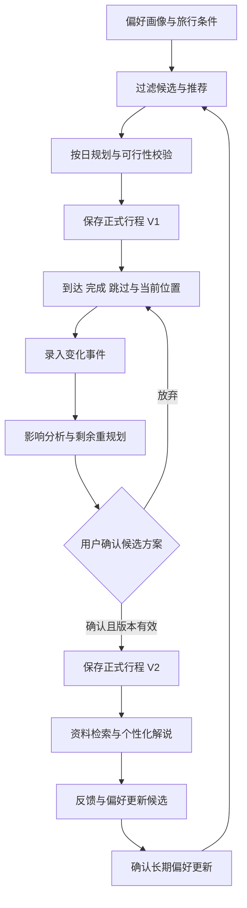
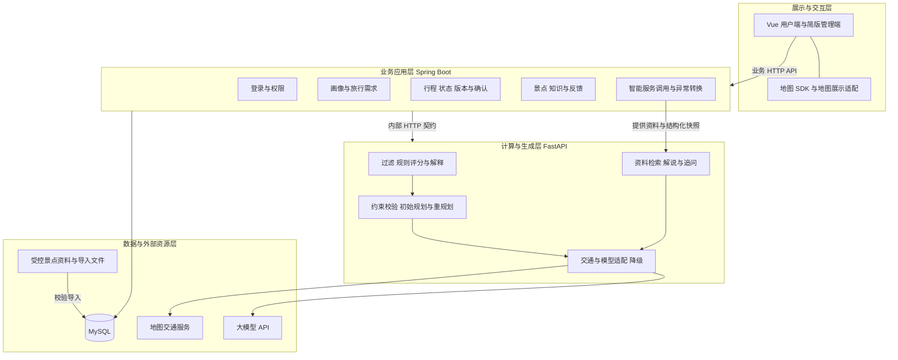
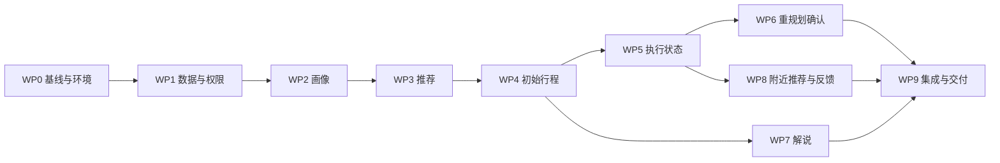

# 旅伴 AI MVP 实现计划

版本：V1.0  
文档性质：MVP 开发与验收主计划，尚未代表系统已经实现或通过验收。  
编制日期：2026 年 11 月 17 日  
适用团队：软件工程 3 班 16 组

## 1 项目简介与当前起点

旅伴 AI 面向自由行游客，帮助用户根据兴趣和旅行条件选择景点、制定可执行行程，并在延误、疲劳、下雨或景点不可用时调整剩余安排。到达景点后，系统提供有资料依据、适应兴趣和可用时间的文字解说；旅行反馈进入下一次推荐。

MVP（最小可行产品）在本项目中指：在一个城市或片区、有限且经过核对的景点数据上，真实跑通业务闭环，验证产品价值。功能数量、算法复杂程度和外部数据覆盖范围均受控制。

### 1.1 资料依据与起点

本计划完整参考以下资料，以项目说明书的产品目标和 P0 范围为主要依据，以第二次作业的工作分解和验收规则补充工程约束，以第三四次作业的依赖关系补充推进顺序。

| 资料 | 本计划采用的内容 |
|---|---|
| [旅伴 AI 项目说明书](C:/Users/Fiona/Desktop/软件项目管理/软件3班16组_旅伴AI项目说明书.docx) | 第 1.3 节核心判断、第 1.7 节功能、第 1.8 节流程与规则、第 1.9 节边界、第 3 节技术路线 |
| [第二次作业](C:/Users/Fiona/Desktop/软件项目管理/软件3班16组_第二次作业(1)(1).docx) | 规则推荐、状态与版本、四类变化场景、反馈规则、工作包和质量门禁 |
| [第三四次作业](C:/Users/Fiona/Desktop/软件项目管理/软件3班16组_第三四次作业(1).docx) | 初始规划到核心闭环的依赖关系、集成与发布前置条件 |

目前提供的是需求和计划材料，没有提供上一阶段实际实现与验收报告，也没有代码或运行证据。因此本计划以“待验证的开发起点”编制，不把文档中的计划写成已完成成果。开始编码前，若已有代码，应先核对可复用能力和实际缺口，并在本文件更新起点。

### 1.2 文档冲突的处理

| 冲突 | 本计划口径 |
|---|---|
| 部分任务将地图列为可选 | 保留基础地图、景点标记和行程线路展示，满足说明书的核心流程 |
| 部分降级方案只保留推荐和解说 | 外部服务故障允许降低展示或生成质量，不删除动态重规划功能；不能把缩减版当成完整验收 |
| 部分任务要求协同过滤、混合推荐 | MVP 使用标签和规则评分，不安排依赖历史用户数据的算法训练 |
| 反馈标为 P1，又是闭环条件 | 保留最小显式反馈更新能力，复杂行为学习延后 |
| 兴趣推送标为 P1，但 M3 要求完成 | 保留行程页内附近推荐、限频、忽略和关闭；不做系统级消息推送 |
| 说明书范围包含多日行程 | 最终 MVP 支持按日组织的短程旅行，以 1—3 日作为本计划建议的产品上限；先用一日场景贯通，再验证两日场景，不能用一日演示替代多日验收 |

1—3 日上限、样例数据规模、具体交互和参数均是本计划的实施建议，不是原资料已有的量化承诺。涉及既有范围变更时，应先记录团队决定，再执行相关改动。

## 2 目标 需求与实现边界

### 2.1 阶段前后变化

阶段前：旅行需求、算法和工程职责主要停留在资料中，尚无经本次核实的运行闭环。

阶段后：用户能在同一系统中完成偏好建立、推荐、地图行程、执行状态记录、变化录入、剩余重规划、方案确认、解说和反馈，刷新或服务重启后仍能读取已保存的业务结果。

### 2.2 需求与交付追踪

| 编号 | 说明书目标 | MVP 场景与需求 | 工作包 | 验收 | 交付物 |
|---|---|---|---|---|---|
| R01 | 1.6 偏好画像 | 可建立、查看、修改画像，区分长期兴趣和本次约束 | WP2 | AC01 | 画像页面、画像接口与存储 |
| R02 | 1.7 基础管理 | 可维护景点分类、关键字段与知识资料 | WP1 | AC02 | 景点管理、数据集和导入脚本 |
| R03 | 1.7 推荐与规划 | 偏好影响排序，推荐具有理由 | WP3 | AC03 | 推荐服务与列表 |
| R04 | 1.7 推荐与规划 | 按日生成、编辑并保存可行行程，地图与时间轴一致 | WP4 | AC04 | 行程服务与旅行工作台 |
| R05 | 1.3 核心差异点 | 记录执行状态，接收五类事件，验证四类核心变化 | WP5 | AC05 | 状态和事件接口 |
| R06 | 1.8 关键规则 | 只调整未完成部分，确认后更新正式版本 | WP6 | AC06 | 重规划、差异展示与确认 |
| R07 | 1.7 自适应解说 | 有资料依据，按兴趣与时间生成两种深度文字 | WP7 | AC07 | 解说服务与界面 |
| R08 | 1.7 兴趣推送 | 当前可访问的附近推荐，可忽略和关闭 | WP8 | AC08 | 页内附近推荐 |
| R09 | 1.8 反馈学习 | 显式反馈形成可追踪更新，影响后续推荐 | WP8 | AC09 | 反馈、画像变更记录 |
| R10 | 3.4 稳定与集成 | 权限隔离、外部失败降级、重启恢复、可重置演示 | WP9 | AC10 | 部署配置、测试证据与阶段报告 |

### 2.3 范围内

- 一个选定城市或片区，建议准备 20—30 个完整景点；数量可调整，但必须支持四类变化下的替代路线和不同兴趣的排序比较。
- 单用户独立行程；提供账号登录和用户数据隔离，管理账号维护景点。
- 兴趣、预算、节奏、同行关系、步行强度，以及本次日期、起点、每日时间范围、交通方式、必去点。
- 采用一种预先选定的出行模式贯通首版，界面明确显示支持的模式；不承诺多模式交通比较。
- 1—3 日短程行程建议范围；每日独立时间窗，跨日共享总预算和已选景点集合。
- 用户手动报告状态，手动选择或确认当前位置；可选浏览器定位不作为验收前提。
- 延误、疲劳、降雨、景点不可用、临时兴趣变化事件；四类核心场景均有独立验收。
- 单个重规划候选方案、原方案差异比较、确认或放弃。
- 简短与详细文字解说、基于资料的简单追问、基础降级内容。
- 行程页内附近推荐、显式反馈和有界的画像权重更新。

### 2.4 范围外与暂缓项

不做机票酒店门票交易、支付、社区、游记、照片整理、全国数据覆盖、商业级实时交通、持续后台定位、自动识别所有突发事件、专业语音和多语言制作。暂缓协同过滤、模型训练、复杂混合推荐、向量数据库、多 Agent 协作、全局最优路线证明、跨城市交通与住宿安排、多人协同编辑。

不建设商业运营后台；管理界面只覆盖样例景点和知识资料维护。不将真实天气自动接入作为前置条件，手动事件可以完成状态更新。

## 3 核心场景与业务闭环

### 3.1 贯穿全计划的示例

示例用户偏好历史文化、低步行强度，计划在演示城市游玩一天，时间为 09:00—17:00。景点 A、B、C、D 为验收数据代号，其开放时间和交通耗时由固定测试数据提供，不能直接当作真实旅游建议。

1. 用户登录，填写偏好和本次旅行条件。
2. 系统过滤不可行景点，推荐 A 博物馆、B 历史街区、C 公园，并解释兴趣匹配与时间条件。
3. 用户生成行程，查看地图、景点顺序、交通段与预计到离时间，确认保存为 V1。
4. 用户完成 A，系统保存完成时间与位置。
5. 用户报告延误 40 分钟并感到疲劳。系统以当前时间、当前位置和剩余预算为输入，仅计算后续节点。
6. 系统给出候选方案：保留 A 的记录，将步行较多的 C 替换为附近的 D，展示时间、步行估计和调整原因。
7. 用户确认，候选方案成为 V2；地图与时间轴同时使用 V2。放弃则继续保留 V1。
8. 到达 D 后，用户选择简短解说，系统依据知识资料与文化兴趣生成内容。
9. 用户反馈喜欢展馆、以后希望少走路；系统展示拟更新内容，确认后保存长期偏好。
10. 在相同候选数据和旅行条件下再次推荐，验证权重与排序变化。

### 3.2 业务流程图



流程中的正式行程、执行状态和画像均由后端保存。算法计算出的候选结果不能直接改变正式业务数据。

### 3.3 必须覆盖的异常

- 没有候选景点：说明过滤条件，允许用户修改约束，不悄悄忽略预算或开放时间。
- 必去点相互冲突：返回冲突原因，请用户选择，不强行生成看似完整的路线。
- 没有可行剩余行程：说明可选的结束或放宽约束操作；未确认前不修改正式行程。
- 用户重复点击：相同请求只产生一次业务效果。
- 候选生成后状态已改变：拒绝确认过期候选，要求基于最新状态重新计算。
- 外部调用失败：提供标明来源和局限的缓存或离线估计，不将模拟数据标为实时事实。

## 4 技术栈与总体架构

### 4.1 技术选择

| 层次 | 选用技术 | 用途及取舍 |
|---|---|---|
| 前端 | Vue 3、TypeScript、Vite、Pinia、Element Plus | 页面、类型约束、状态管理和表单；统一使用一套组件库 |
| 地图 | 一家地图 SDK，经适配模块接入 | 地点标记、线路、交通时间；具体供应商在开发前核对覆盖、条款和额度 |
| 业务服务 | Spring Boot、Spring Security、JWT、MyBatis | 业务接口、鉴权、事务、数据读写；JWT 为登录后携带的身份凭证 |
| 智能服务 | Python、FastAPI、Pydantic | 规则推荐、行程计算、重规划、知识检索和模型调用；Pydantic 校验输入输出结构 |
| 持久化 | MySQL | 保存账号、画像、景点、行程版本、状态、事件与反馈 |
| 缓存 | 首版进程内有界缓存 | 缓存交通查询和解说，重启丢失可重算；Redis 暂缓启用，避免增加首版部署依赖 |
| 大模型 | 一家可配置的 LLM API | 意图辅助理解、解说和资料内追问；模型名称、额度和密钥由配置提供 |
| 质量与部署 | JUnit、pytest、接口测试、Playwright、Docker Compose | 分层验证、端到端验证、统一启动和演示重置 |

Redis 的暂缓属于本计划对原技术草案的简化建议。所有关键数据均直接落 MySQL，不能依赖缓存保证一致性。具体版本在 WP0 核验兼容性后锁定，前端提交锁文件，Python 使用锁定依赖，Java 固定依赖版本。

### 4.2 技术架构图



浏览器只访问业务接口；地图 SDK 按供应商要求使用受域名限制的浏览器凭证。智能服务在内部网络提供计算，不拥有正式行程的写入权。后端传入所需数据快照，接收结果并重新校验后持久化，减少两个服务直接修改同一业务对象的问题。

### 4.3 各层设计说明

**展示与交互层**负责输入、结果展示和确认。Pinia 只保存当前页面使用的服务端快照及未提交表单；刷新后从服务端恢复。地图和时间轴读取同一个 `tripVersion`，禁止各自维护不同路线。前端不自行决定确认候选是否有效。

**业务应用层**是业务事实的唯一维护入口。控制器校验请求，应用服务执行用户权限、状态转移和事务，数据访问层负责 MySQL。画像与行程操作均检查归属；管理员权限只用于基础资料维护。外部失败转换为可理解的错误或降级标记。

**计算与生成层**尽量采用无状态计算：输入结构化快照，输出结果和理由，不保存正式用户状态。推荐和规划使用规则及约束算法，大模型不承担开放时间、预算或路线可行性的最终判断。输出包含计算规则版本，方便复现。

**数据与资源层**保存可恢复事实和可核对资料。数据文件经校验导入数据库，知识内容保留来源、采集日期和版本。交通与模型均通过适配接口访问；固定测试使用固定适配数据，在线验收另外记录真实调用结果。

### 4.4 建议代码结构

```text
travelmate-ai/
  frontend/src/{pages,components,stores,api,map}
  backend/src/main/java/.../{auth,profile,attraction,trip,feedback,ai,common}
  intelligence/app/{contracts,recommendation,planning,replanning,guide,adapters}
  data/{attractions,knowledge,fixtures}
  tests/{contract,e2e,acceptance}
  deploy/{compose.yaml,env.example}
  scripts/{seed,reset-demo,smoke}
  docs/旅伴AI_MVP实现计划.md
  docs/旅伴AI_MVP实现与验收报告.md
  evidence/
```

此处为待创建的建议结构，不表示这些路径现在已有代码。每阶段沿用一份主计划和一份实现与验收报告；日志、接口响应和测试结果放入 `evidence/`，不再新建重复的用户说明文档。

## 5 各模块实现设计

### 5.1 账号与权限

目的：将画像和旅行记录绑定到正确用户，避免不同用户互相修改数据。

实现：简版注册、登录、退出和当前用户查询；密码使用成熟的单向哈希方案保存；首版可提供演示账号，管理账号通过初始化脚本创建。业务请求从服务端登录上下文取得用户 ID，不信任前端提交的归属字段。令牌过期后保留本地未提交表单并提示重新登录。

输入为账号密码，输出为身份凭证及用户基础信息。错误密码返回统一提示；缺少凭证返回 401，无权限返回 403。验证登录失败、过期和跨用户访问。暂缓找回密码、第三方登录、复杂角色体系。

### 5.2 景点与知识资料

目的：为筛选、规划、替代景点和可靠解说提供同源数据。

最小字段：ID、名称、城市、分类、标签权重、经纬度、开放时间段、闭馆日期、门票估计、建议停留分钟、室内外属性、步行强度、启用状态、知识资料和来源。费用字段明确是估计值，首版预算只覆盖录入的门票和交通估计，不宣称覆盖全部旅行消费。

实现：CSV/JSON 批量校验导入；简版管理页支持新增、修改、查询和分类筛选。知识采用景点 ID 关联文本段，每段有主题标签和来源。资料检索先按景点过滤，再按问题关键词和兴趣标签排序，无需向量数据库。

缺关键字段的记录不能进入可规划候选集；管理修改不覆盖旧行程保存的快照。验证字段错误、闭馆日期、来源缺失和样例数据可重置。

### 5.3 画像与本次需求

目的：让推荐、规划、附近推荐和解说使用一致偏好，并避免临时疲劳污染长期兴趣。

分三类保存：长期画像 `Profile`，如历史文化兴趣和常用步行强度；本次需求 `TripRequest`，如日期、每日起止时间、总预算、起点和必去点；即时状态 `TripState`，如当前位置、当前时间、疲劳和天气事件。

实现：问卷选项映射为有界权重，首版采用 0—1 范围。权重由版本化配置提供，画像保存版本号。修改长期画像影响下一次计算，不自动改写已确认行程。缺省值与用户明确输入分开记录。

输入为问卷与需求表单，输出为可查看修改的结构化画像和需求。非法时间、负预算等在前后端校验。通过不同兴趣、修改画像和刷新恢复验证。

### 5.4 推荐与解释

目的：从有限候选中挑选适合用户的地点，并说明依据。

实现步骤：先过滤城市、启用状态、明确闭馆、预算不可承受等硬约束；再计算兴趣匹配、移动成本、游览耗时和基础质量的加权分；最后按稳定规则排序，相同分数按景点 ID 打破并列。某景点单独可访问不代表多个景点组合可行，组合约束由规划模块继续检查。

示意公式：`score = w1 × interest + w2 × proximity + w3 × timeFit + w4 × quality`。各特征归一化，权重写入配置；公式不代表已验证最优。推荐理由直接由命中规则生成，如“匹配历史兴趣、室内场所、预计游览 60 分钟”，无需大模型编造理由。

输入为画像、旅行条件和景点快照，输出为候选、分数、理由、排除摘要和规则版本。无候选返回结构化原因。用固定输入复现排序，并比较不同兴趣画像。

### 5.5 初始行程与编辑

目的：将景点列表转成包含交通和时间的可执行安排。

首版采用启发式规划，即按明确规则逐步选择可行景点，不承诺全局最优。先安排必去点，再尝试插入高分候选，每次插入重新计算交通、到达、等待、游览结束时间和累计费用；超过时间窗或预算则拒绝该插入。小规模候选可比较有限的插入位置，设置计算上限。

每个景点需满足 `开始游览时间 ≥ 到达时间`，且完整游览区间落在开放时间段内；当天结束时间包含最后一段交通是否回到指定终点，由需求中的终点配置决定。所有时间采用城市时区和明确日期，不能仅存“下午三点”字符串。

多日安排按日期依次计算，扣减共享预算，避免重复分配景点；本计划不处理住宿与跨城衔接。用户增删、调整顺序后先校验再保存；失败返回冲突详情，保留原版本。

输出含每日节点、交通段、预计到离时间、费用估计及数据来源。交通不可用时使用预置矩阵或明确标注的保守估计；无可靠估计时不宣称在线路线已经可执行。验证开放时间、必去点、预算、两日不重复和编辑冲突。

### 5.6 执行状态与事件

目的：知道哪些旅行事实已发生，为重规划划定可修改边界。

节点状态为 `NOT_STARTED`、`IN_PROGRESS`、`COMPLETED`、`SKIPPED`、`CANCELLED`，分别表示未开始、进行中、已完成、已跳过和已取消。首版允许未开始进入进行中、跳过或取消，进行中进入完成或取消；终态不通过普通接口回退。完成操作记录实际时间，不能以预计时间代替实际记录。

事件包含类型、发生时间、当前位置、结构化参数、输入来源和客户端请求 ID。支持延误分钟、疲劳等级、降雨、不可用景点 ID 和本次兴趣调整。自然语言辅助解析必须向用户展示识别结果，再提交结构化事件；按钮入口始终可用。

进行中的节点保持当前访问状态，重规划从用户确认的当前位置和剩余停留安排开始；首版若需中途离开，应显式结束或取消该节点后再算，不能默认把它当作已完成。

状态修改增加状态版本号，重复请求去重；非法转移拒绝。验证重复完成、越权、历史保留和事件参数错误。

### 5.7 剩余重规划与版本确认

目的：在变化后继续提供合理路线，保护已经发生的事实。

处理流程：读取正式行程和状态快照；冻结已完成、跳过、取消等历史记录；确定受影响的未完成节点；将事件转为本次约束；调用与初始规划共用的可行性引擎重算剩余部分；生成一个候选和差异说明。

延误改变剩余可用时间；疲劳降低本次步行上限；降雨过滤或降低天气敏感地点优先级；关闭事件排除指定景点；临时兴趣只改本次评分。重算始终考虑已经支出的估计或已录入费用，不能重置整次预算。只有真正受影响的未来日期才需要重新安排。

候选保存 `baseTripVersion`、`baseStateVersion`、画像/数据快照标识、生成时间和过期时间。确认时再次核对版本和时效；存在变化则返回 409，并要求重新生成。通过数据库事务将新版本、当前版本指针和确认记录一起提交，任一步失败均回滚。相同确认请求重复提交返回已确认结果。

输出差异包括新增、删除、替换、顺序变化、时间变化和规则原因。无解时返回冲突，不破坏当前行程。验证四类变化、放弃、过期、并发状态变化、重复确认和事务失败。

### 5.8 自适应解说与追问

目的：让同一景点的讲解重点随用户兴趣和可用时间变化，并保持事实可核对。

输入为当前景点、画像快照、解说深度、可用分钟、问题及检索资料。先选相关片段，再拼装受约束提示词，要求只使用提供的事实；不支持的问题返回资料不足。输出正文、引用资料 ID、模式、生成来源和降级标记。资料中的文字只作为知识内容，不作为工具或业务操作指令。

简短模式控制阅读量，详细模式增加背景；具体字数和时间映射作为配置，在样例评审后固定。可用时间极短时即便选择详细，也提示并返回适当压缩内容。缓存键包含景点知识版本、兴趣摘要、深度和语言，避免错用其他用户的个性化结果。

模型超时后返回基础模板或缓存，不阻断行程。来源标签只能证明资料关联，事实性仍需固定样例人工核对；自动测试验证结构、引用和降级。暂缓语音播放器与开放域旅游问答。

### 5.9 附近推荐与反馈更新

附近推荐根据当前位置、当前时间、兴趣、开放条件和剩余时间筛选，输出距离、理由和预计耗时。仅在用户打开面板、到达或行程确认后按规则刷新，不做持续轮询。忽略项在本次旅行内抑制，关闭状态持久化；加入正式行程仍需规划校验和用户确认。

反馈对象明确区分景点、路线强度和解说。喜欢景点影响其兴趣标签，路线太累影响步行强度，解说太长影响解说长度。不能用解说差评直接降低景点兴趣。

首版使用有界增量规则，例如显式喜欢使相关标签增加配置步长，取值限制在 0—1；示例步长 0.1 仅为待校准参数。长期变更先展示候选，用户确认后生效；临时状态仅影响本次旅行。反馈及更新保存规则版本、前后值和原因。重复反馈请求不能重复加权。

验证同一反馈只应用一次、反馈类型影响正确字段、更新拒绝不生效、确认后下次推荐变化。附近推荐的忽略不自动推断用户永久不喜欢该兴趣。

## 6 数据 接口与错误契约

### 6.1 最小数据对象

| 对象 | 关键内容 | 保存与恢复 |
|---|---|---|
| User | 账号、密码哈希、角色 | MySQL，重启恢复 |
| Profile / ProfileChange | 权重、版本、变更候选与前后值 | MySQL，确认后更新 |
| Attraction / KnowledgeFragment | 景点属性、资料、来源、版本 | MySQL；原始导入文件受版本管理 |
| Trip / TripVersion | 归属、需求快照、正式版本指针 | MySQL；旧版本保留 |
| TripNode / TravelLeg | 计划时间、交通估计、景点快照 | 绑定行程版本 |
| NodeExecution / TripState | 实际记录、当前位置、状态版本 | 与历史计划版本分开保存，不因新版本删除 |
| ChangeEvent / ReplanProposal | 事件、基准版本、候选、差异、过期时间 | MySQL，可追溯 |
| GuideRecord | 解说、资料引用、模型与知识版本、降级状态 | MySQL，支持恢复已展示内容 |
| Feedback / PreferenceUpdate | 反馈对象、请求 ID、规则版本和应用状态 | 唯一约束去重 |

执行记录使用稳定的业务节点标识，计划版本内节点引用该标识；已完成节点不会因复制新版本而变成另一条未完成记录。服务启动不自动清空数据，重置只作用于明确标记的演示数据。

### 6.2 主要业务接口

以下路径为待实现契约草案，WP0 固定字段后前后端共同使用。

| 方法与路径 | 输入 | 输出与约束 |
|---|---|---|
| POST `/api/auth/login` | 账号密码 | 令牌及用户信息 |
| GET / PUT `/api/profile` | 画像及预期版本 | 当前画像；冲突拒绝 |
| GET `/api/attractions` | 分类、标签、分页 | 景点列表 |
| POST / PUT `/api/admin/attractions` | 景点资料 | 管理权限和字段校验 |
| POST `/api/recommendations` | 本次条件 | 候选、分数、理由 |
| POST `/api/trips` | 旅行条件、请求 ID | 初始正式行程 |
| GET `/api/trips/{id}` | 行程 ID | 正式版本与执行状态 |
| POST `/api/trips/{id}/edits` | 基准版本和变更 | 校验后新版本或冲突 |
| POST `/api/trips/{id}/nodes/{nodeId}/status` | 预期状态版本、目标状态 | 实际状态记录 |
| POST `/api/trips/{id}/events` | 事件与请求 ID | 保存事件及新状态版本 |
| POST `/api/trips/{id}/replan-proposals` | 事件 ID、基准版本 | 候选、差异、过期信息 |
| POST `/api/replan-proposals/{id}/confirm` | 请求 ID、基准版本 | 新正式版本 |
| POST `/api/replan-proposals/{id}/discard` | 候选 ID | 标记放弃，不改正式行程 |
| POST `/api/guides` | 景点、深度、可用时间、问题 | 解说、资料引用、降级标记 |
| GET `/api/trips/{id}/nearby` | 当前状态 | 附近候选与过滤条件 |
| PUT `/api/profile/push-settings` | 开关 | 保存设置 |
| POST `/api/feedback` | 对象、反馈类型、请求 ID | 反馈及更新候选 |
| POST `/api/profile-changes/{id}/confirm` | 预期画像版本、请求 ID | 新画像版本 |

内部计算接口采用 `/internal/recommend`、`/internal/plan`、`/internal/replan`、`/internal/guide`，只允许业务服务访问。契约包含 `requestId`、`schemaVersion`、输入快照标识和 `algorithmVersion`；智能服务返回可行性、理由、警告与来源，禁止返回可执行 SQL 或任意业务写入指令。

### 6.3 示例与错误规则

```json
{
  "eventType": "DELAY",
  "occurredAt": "2026-11-17T11:40:00+08:00",
  "parameters": {"delayMinutes": 40},
  "expectedStateVersion": 3,
  "clientRequestId": "demo-trip-delay-001"
}
```

该时间仅为输入格式示例；实际演示日期由测试数据决定。位置可引用已确认景点或另行提交坐标。

错误响应统一包含 `code`、`message`、`details`、`requestId`。400 表示输入无效，401/403 表示身份或权限问题，404 表示资源不可访问，409 表示版本、状态或重复请求内容冲突，422 表示约束下无可行方案，503 表示暂不可用且无可用降级。已有降级结果则返回成功响应并附 `degraded: true`，不能同时伪装为正常实时结果。

### 6.4 取消 超时与重试

前端取消请求会停止等待和展示，不等于服务端已撤销写入。写入操作使用请求 ID，用户恢复页面后查询最终状态。模型与交通调用设置可配置的超时和少量重试，总时间受上限控制；不对非幂等写入进行盲目重试。候选过期或放弃后不能确认，计算异常不修改正式版本。

## 7 模型 工具与配置

首版不引入 Agent 自主编排。业务后端按固定流程调用推荐、规划和解说服务；大模型仅参与文字理解与生成。自然语言识别结果必须转为经校验的结构化参数，确认后才进入业务计算。

配置分为：算法权重、事件约束、模型供应商和名称、调用超时、输出长度、交通数据来源、附近推荐频率、候选有效期、JWT 配置和数据库连接。密钥放环境变量，仓库仅提交无密钥示例；用户文本和位置不进入公开日志。日志以请求 ID 串联服务调用，保留错误分类和版本，不记录密码或令牌。

## 8 工作包与依赖顺序

每个工作包完成都必须具备实际入口、正常与关键异常验证，以及可复现证据。局部函数返回成功不代替整条业务链验收。下表中的新建以目前未提供代码为前提；若发现已有实现，核对后标记为复用或修改。



| 工作包 | 目的、前置与模块 | 实施步骤及输入输出 | 失败、重复与取消处理 | 验证与完成定义 |
|---|---|---|---|---|
| WP0 基线与工程 | 确认范围；无代码前置；影响全工程和部署 | 核对既有代码；选演示城市与出行模式；锁定字段、API、样例与依赖；建三端骨架和项目 Conda 环境；输出可启动骨架 | 外部服务未选定时采用明确的固定适配数据，不把其当作在线能力 | 健康检查、环境隔离和空库迁移通过；需求冲突有决定记录 |
| WP1 数据与权限 | 支撑 R02/R10；依赖 WP0；`auth/attraction/data` | 建表与迁移、账号鉴权、导入校验、简版管理；输入原始资料，输出可查询候选和知识 | 导入错误逐行报告；演示导入按稳定 ID 幂等；中断不留下半批有效数据 | AC02、权限基础通过；数据可重置且能支撑四类替代场景 |
| WP2 画像闭环 | 支撑 R01；依赖 WP1；`profile/pages` | 定义选项与权重；完成问卷、保存、查看、修改；输出版本化画像 | 输入无效不覆盖旧值；版本冲突拒绝；重复请求不累加 | AC01 通过，刷新和重启恢复 |
| WP3 推荐闭环 | 支撑 R03；依赖 WP2；`recommendation/api` | 实现过滤、评分、稳定排序、理由和列表；画像与条件转候选 | 无候选给解释；取消不写状态；计算可重复 | AC03 通过，理由可追踪到规则和资料 |
| WP4 初始行程 | 支撑 R04；依赖 WP3；`planning/trip/map` | 接交通适配；建时间与费用模型；一日贯通后扩展按日分配；实现编辑、持久化和地图同步 | 无解返回冲突；重复创建只生成一个行程；编辑失败保留原版 | AC04 通过，完成真实页面到数据库全链路 |
| WP5 执行与事件 | 支撑 R05；依赖 WP4；`trip/state` | 状态机、实际记录、位置确认、事件表单；输出可复现状态快照 | 非法状态拒绝；事件去重；取消等待后可查询提交结果 | AC05 通过，历史与新计划分离 |
| WP6 调整与确认 | 支撑 R06；依赖 WP5；`replanning/trip/pages` | 复用规划校验；转换事件约束；冻结历史；生成差异；事务确认 | 无解不覆盖；过期拒绝；重复确认幂等；放弃保留原版 | AC06 通过，包括四类变化、并发和失败回滚 |
| WP7 现场解说 | 支撑 R07；依赖 WP4 和知识资料；`guide/adapters` | 简单检索、提示模板、两种深度、追问、缓存与降级 | 超时退回资料模板；资料不足明确提示；取消不写行程 | AC07 通过，人工事实核对与自动测试分别记录 |
| WP8 回流与附近机会 | 支撑 R08/R09；依赖 WP5、推荐和解说入口；`feedback/profile/nearby` | 过滤附近候选；实现关闭忽略；反馈分类、去重、更新候选和确认；再次推荐 | 重复反馈不加权；拒绝更新不改画像；忽略只影响本次抑制 | AC08/AC09 通过，证明反馈进入下次决策 |
| WP9 集成与交付 | 支撑 R10；依赖 WP6—8；`tests/deploy/evidence/docs` | 完成全流程、异常、权限、重启和部署验证；冻结样例与配置；更新唯一阶段报告 | 保存失败和部分通过记录；修复后新增复测证据；不降低原标准 | AC01—10 必要项通过，遗留项明确，部署可复现 |

角色建议：P1 维护范围、计划和集成；P2 实现前端；P3 实现业务与数据；P4 实现计算与生成；P5 设计验收并复测。成员姓名映射以团队实际决定为准，不根据性格描述推断能力或工期。

## 9 验收设计与通过条件

验收数据、输入和预期性质在相关工作包实施前固定。自动检查由开发者编写并执行，P5 或非该模块实现者复核；人工事实审查单独记录，不能把模型自述当作独立验收。

| 编号 | 正常、失败与边界场景 | 明确通过标准 |
|---|---|---|
| AC01 | 创建修改画像、错误输入、跨用户读写、重启 | 正常持久化；非法输入拒绝；他人不可访问；恢复后版本和值一致 |
| AC02 | 导入增改查、缺字段、闭馆、多来源资料 | 不合格记录不进入规划；分类可筛选；资料来源可核对；重置可重复 |
| AC03 | 两种兴趣、并列分数、全过滤、相同输入 | 预设差异样例出现合理排序差异；理由匹配规则；同版本固定输入稳定；无候选可解释 |
| AC04 | 一日和两日、开放时间、多时间段、预算、必去点冲突、编辑 | 每段交通计入；完整游览在开放段内；共享预算不超；跨日不重复；冲突不保存；地图时间轴版本一致 |
| AC05 | 到达完成跳过、重复完成、非法回退、五类事件输入 | 状态合法；实际记录不重复；历史保留；事件和状态版本可追踪 |
| AC06 | 延误、疲劳、降雨、关闭；无解；过期；并发；重复确认；放弃 | 四类固定可解样例均满足新约束；历史记录字段不变；差异可解释；仅有效确认生效一次；无解或失败不破坏正式版 |
| AC07 | 两种兴趣、两种深度、短时间、追问、无资料、模型中断 | 内容重点和长度按规则变化；关键事实人工核对无未解决错误；引用对应资料；不确定内容不编造；降级可识别 |
| AC08 | 开放与关闭地点、距离边界、忽略、关闭开关 | 返回项符合时段和配置范围，理由耗时完整；忽略后本次不重复；关闭后不主动展示；加入行程再次校验 |
| AC09 | 喜欢、太累、解说太长、重复、拒绝、确认、画像冲突 | 各自只影响对应维度；重复只应用一次；拒绝不更新；版本冲突不覆盖；确认后固定样例的下一次推荐或相关输出出现预期差异 |
| AC10 | 全链路、跨用户、断开模型/交通、刷新、服务重启、干净部署 | 主线连续完成；无越权；降级不冒充实时；已保存数据恢复；按说明可启动重置；无阻断缺陷 |

性能在固定演示机器记录：数据规模、冷暖缓存、计算和外部调用时间分别报告。内部推荐和规划目标为交互可等待的秒级返回；具体门槛在 WP0 基准样例中固定后才作为验收数值，不用未经测量的响应时间宣传完成情况。

证据至少包含输入、预期、实际输出、环境、数据和规则版本、执行人、审查人、结果及缺陷编号。外部模拟测试与真实服务测试分别标记。网络断开演示成功，只证明降级路径，不代表实时交通能力通过。

## 10 本地启动与动手验证路线

以下为实现时必须提供的启动约定，当前尚无仓库和脚本，不能视为已经可执行的现成系统。

### 10.1 环境约定

Python 项目依赖和执行使用独立 Conda 环境 `D:\miniconda3\envs\travelmate-ai-mvp`，不得使用 base 或其他项目环境。Java、Node、数据库等外部运行时按项目配置锁定；前端依赖安装在项目内，数据库由 Compose 管理。创建环境需要写入上述项目环境目录，执行时遵循实际机器授权要求。

### 10.2 操作员与脚本步骤

1. 克隆代码，复制 `deploy/env.example` 为本地配置，填写数据库、JWT 和可选外部服务参数。
2. 创建并激活项目 Conda 环境，安装锁定的 Python 依赖；安装锁定的前端依赖并构建 Java 服务。
3. 用 Compose 启动数据库，执行数据库迁移、演示账号和数据初始化。
4. 启动 FastAPI、Spring Boot 和 Vue 开发服务器；依次检查数据库、智能服务和业务服务健康状态。
5. 执行冒烟检查脚本，确认登录、景点查询、推荐和行程创建。
6. 需要恢复演示时运行 `reset-demo`，先显示目标数据库与演示标识；不得默认清空生产或非演示数据。

实现报告必须补上实际端口、启动命令、依赖版本和命令输出，禁止把本节约定原样当成部署成功证据。

### 10.3 用户界面验证步骤

1. 使用演示账号登录，填写历史文化和低步行偏好。
2. 选择演示日期、09:00—17:00 与预算，查看推荐理由，生成并保存一日行程。
3. 比较地图和时间轴，完成第一个节点。
4. 提交延误 40 分钟与疲劳，查看候选差异，先放弃一次，再重新生成并确认。
5. 刷新页面，确认新行程和历史完成记录仍在。
6. 到达替代景点，比较简短和详细解说；关闭模型服务，验证基础内容和降级提示。
7. 提交喜欢展馆、减少步行的反馈，确认画像变更，再以同条件获取推荐。
8. 使用另一账号，验证无法读取或修改上述行程；再验证两日规划与另外三类变化。

## 11 执行与变更控制

先固定契约、测试数据和验收性质，再实施功能闭环。前端可用固定样例开发，但工作包完成必须接入真实业务接口与数据库。规则参数优化、可逆实现选择和缺陷修复可在本计划范围内推进并记录。

以下变化需先呈现具体方案及影响，再由项目负责人组织决定：删除动态重规划或地图、取消反馈回流、缩减多日范围、引入付费服务或突破批准额度、扩大数据写入权限、更换核心架构造成交付范围变化。历史计划中的预算模型不自动构成实际采购授权。

失败尝试、未通过项和局部通过项保存在证据中。修复后增加版本化复测结果，不改写旧结果，也不通过放宽验收条件把失败改为成功。若某必需功能未完成，交付状态应为部分完成，并明确对闭环的影响。

## 12 交付物与后续边界

本阶段交付：源代码、锁定依赖、迁移与样例数据、统一启动配置、可操作的完整 MVP，以及唯一的《旅伴 AI MVP 实现与验收报告》。本文件持续作为主执行计划维护。验收报告应讲清实际前后变化、真实入口、架构与模块、一个任务全链路、数据恢复、关键代码链接、操作教程、证据、限制和遗留项。

在全部必要闭环和验收证据具备前，不标记本阶段完成。后续再根据实际使用结果考虑更多城市、更多交通模式、自动状态感知、复杂推荐和向量检索；这些不作为本阶段交付条件。

本计划要实现的最终体验是：用户完成一个景点后发生延误和疲劳，旅伴 AI 保留已完成记录、解释并调整剩余路线，经用户确认继续导览，最后将明确反馈用于下一次旅行决策。
