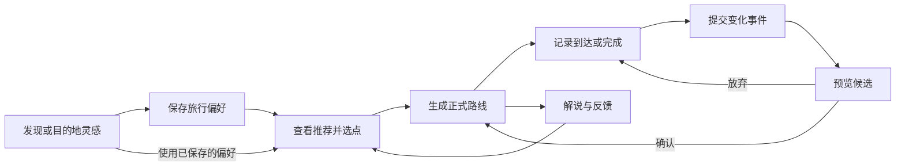
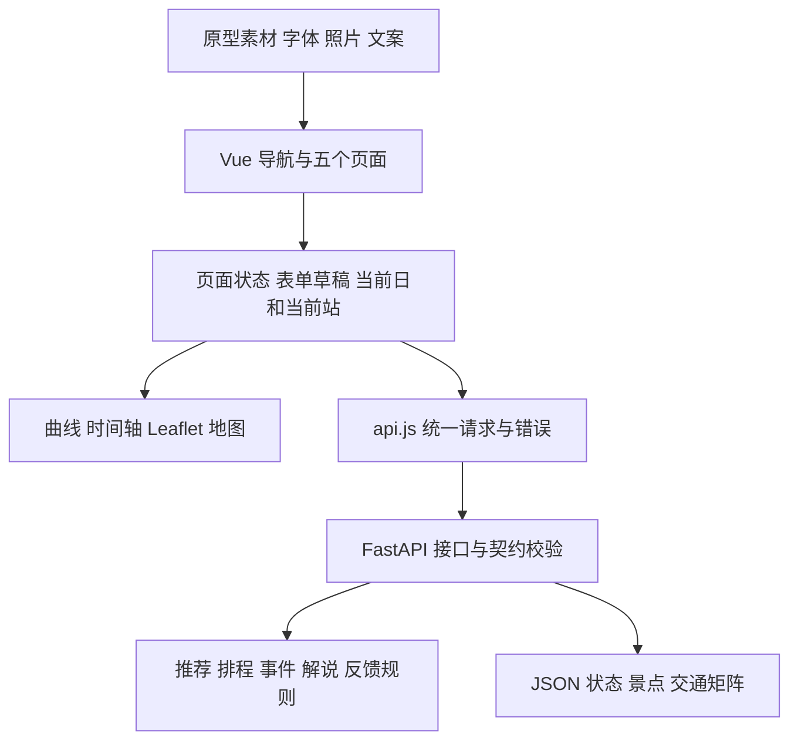

# 旅伴 AI 原型前端整合设计与实施计划

版本 V1.0 · 2026 年 11 月 20 日 · 实施与复测中

## 1. 项目简介与阶段起点

旅伴 AI 是一个用于展示自由行规划流程的本机 Demo。用户填写兴趣与时间预算，查看景点推荐，生成一日或两日路线，在出行条件变化时比较调整方案，也可以查看解说并用反馈影响下次推荐。

| 基线 | 在本阶段的作用 |
|---|---|
| [Demo 总计划 V2.2](D:/pm/旅伴AI_MVP实现计划.md) 第 1–6、8、11 节 | 定义业务目标、技术栈、演示边界、接口与 AC1–AC10 验收标准 |
| [前一阶段实现与验收报告](D:/pm/旅伴AI_Demo实现与验收报告.md) 第 9、10 节 | 第 9 节记录视觉迭代，第 10 节记录本机应用及既有测试结果。历史结果中地图与完整界面流程仅部分确认 |
| [轻表单与曲线路线 HTML 原型](D:/pm/旅伴AI-表单与曲线路线版.html) | 以该文件中的最新版中文文案、五页结构、照片、表单、路线和弹窗为界面基准 |
| [接口契约 1.0.0](D:/pm/contracts/api-v1.json) | 前端调用现有服务的字段与返回格式，以它和实际服务为准 |

早期完整 MVP 历史稿可用于追溯，当前功能范围按 V2.2。V2.2 的三个页面是功能分组，本阶段将这些功能放入原型的五项导航。原型中多城市切换、浏览器端模拟算法等交互只用于理解原设计，业务能力以 V2.2 和接口为准。

已知问题可从源码定位：当前 [App.vue](D:/pm/frontend/src/App.vue) 的 `recommend()` 将页面设为 `discover`，模板只有 `work` 和 `settings` 显式分支，末尾的 `v-else` 会让该值落到景点管理。前一阶段 17 项自动化测试是后端证据，这个前端缺陷仍须用浏览器复测。

## 2. 目标、需求与实现边界

交付后，从应用根地址打开的是原型风格的「发现」首页。用户通过「旅行偏好」或「目的地灵感」开始规划，在「我的旅程」里完成推荐、选点、排程和途中调整，在「景点管理」维护演示数据。界面上的路线、候选、解说和反馈结果都由本机 FastAPI 提供。

| 需求 | 本阶段交付 | 对应验收 |
|---|---|---|
| D1 原型布局与交互 | 五项导航、全幅照片、图文节奏、中文标题、轻表单、曲线与照片行程卡 | P1、P2、P5 |
| D2 偏好到行程 | 表单保存、按偏好推荐、选点或按推荐生成一日/两日路线 | P3–P5，AC1、AC3 |
| D3 途中闭环 | 到达、完成、跳过、变化事件、候选对比、确认/放弃 | P6，AC5 |
| D4 行中辅助 | 分深度解说与来源、附近显示与开关、反馈后重荐 | P7，AC6–AC8 |
| D5 数据与演示维护 | 景点搜索、分类、增改、启停、重置、刷新恢复 | P8、P9，AC2、AC9 |
| D6 实际操作验收 | Codex 内置浏览器走通正常、异常及窄屏场景 | P10，AC4、AC10 |

阶段边界是单机单用户、固定香格里拉原型景点资料、固定交通耗时、预置解说。目的地灵感页面展示原型的城市照片和介绍，卡片是「灵感展示」；当前规划路线明确使用原型默认香格里拉的景点，不把其他城市地点混进路线。行中附近推荐支持查看、忽略、开关，行中插入新点仍受现有契约限制。解说以文字和来源为必交付；原型内嵌音频与现有预置文本没有对应契约，本轮将原型播放器外观作为参考，语音播放不列入交付。真实模型、实时导航、账户和公网部署继续按总计划边界处理。

## 3. 用户场景、入口与业务闭环

| 用户目的 | 入口 | 完成时看到什么 |
|---|---|---|
| 了解产品 | 根地址 → 发现 | 原型照片首屏、应用简介、规划与目的地入口 |
| 浏览目的地 | 目的地灵感 → 卡片详情 | 中文图文、主题图片、当前路线目的地说明，可进入偏好设置 |
| 找合适景点 | 首页「看看适合我的景点」或保存偏好后继续 | 「我的旅程」内的推荐区定位到视口，显示加载、结果、空结果或失败重试 |
| 安排游览 | 我的旅程 → 推荐区 → 生成路线 | 日期、费用、每日站点、到离时刻、曲线、时间轴与可展开地图 |
| 继续已保存的旅行 | 我的旅程 | 首次进入读取正式行程、执行状态和未处理的候选 |
| 应对变化 | 我的旅程 → 途中调整 | 查看调整前后差异，确认后正式路线更新，放弃后保留原路线 |
| 查看或维护内容 | 地点卡解说入口／景点管理 | 查看带来源的解说，或编辑景点资料且在刷新后看到保存结果 |

贯穿示例：在干净的演示数据目录里选择历史文化优先、一天、轻松，保存后查看推荐并生成行程。到达并完成第一站，提交延误事件。确认候选前对照第一站记录和后续到离时间，先放弃一次，再提交并确认一份有效候选。打开一处景点解说，提交一次「喜欢」，重新推荐并检查对应偏好和排序。两日换日、无解等分支使用各自的固定样例，避免用碰巧可行的数据替代验收。



## 4. 技术栈、架构与分层职责

采用 Vue 3、Vite、现有 Element Plus 组件、CSS、SVG 和 Leaflet。后端沿用 FastAPI 与 Python，使用 `D:\miniconda3\envs\pm`。业务以 Python 规则运行，解说用 `GUIDE_MODE=preset`。JSON 文件保存本机状态，接口格式由契约 1.0.0 定义。



| 层 | 输入和输出 | 设计理由 |
|---|---|---|
| 视觉素材层 | 原型照片、中文字体、文本与样式 → 本地资源与设计变量 | 使用工作区素材与既有许可证，按需切分出所用资源。首屏以外的照片延迟加载 |
| 页面层 | 导航、已保存数据、表单动作 → 页面与反馈 | `App.vue` 负责导航、启动和共享状态，五页按功能拆分组件；各页面有明确分支和可恢复的错误提示 |
| 视图联动层 | 正式 Trip 的当日节点与选中 ID → 曲线、卡片和地图 | 以同一份节点列表渲染，曲线路径坐标只是排版，时间、顺序和收费来自后端 |
| 请求层 | 方法、路径和 JSON → 解包结果或中文错误 | 复用 `frontend/src/api.js`，统一转译错误，让每个操作有明确的进行中和重试状态 |
| 接口和规则层 | 用户约束与事件 → 推荐、行程或候选 | 复用 `backend/app/main.py` 与 `engine.py`。展示调整遇到限制先核对契约和行为 |
| 存储层 | 已确认的状态变化 → 本机演示文件 | 复用 `backend/app/storage.py`；新增 UI 草稿只存在浏览器页面内，刷新从服务恢复已保存数据 |

建议代码落点以当前目录为基准。`frontend/src/App.vue` 保留编排，`frontend/src/views/` 放页面，`frontend/src/components/` 放可复用的曲线、行程卡等组件，`frontend/src/TripMap.vue` 继续负责 Leaflet，`frontend/src/style.css` 整合从原型提炼的公共样式。照片优先复用 `frontend/public/images` 和 `prototype-assets`，缺失时从原 HTML 提取所需资产。原 HTML 继续作为可双击查看的对照材料。

## 5. 页面与模块实现说明

### 5.1 发现与公共导航

按原型恢复全幅照片首屏、「出发，去喜欢的地方」中文标题、图文欢迎区和照片画廊。导航项为发现、目的地灵感、我的旅程、旅行偏好、景点管理。首页顶栏随背景使用可读的透明样式，内页回到暖白底，选中项以下划线呈现。窄屏可见全部入口，长导航允许横向滚动。品牌采用原型更新后的字样，手写体集中用于原型规定的中文主标题。

使用明确的页面标识与 URL hash，例如 `#home`、`#destinations`、`#work`、`#settings`、`#places`，刷新与浏览器前进后退可恢复对应页面。未知 hash 回发现。CTA 切换到 `#work` 并定位推荐区，再展示请求状态。将「进入推荐」和「刷新推荐数据」拆开，行中反馈后的刷新留在当前操作位置。

### 5.2 目的地灵感

从原型迁移目的地页头、图片卡、中文介绍和详情弹窗。卡片输入为静态的名称、照片和主题说明，输出为详情或进入规划设置。每张照片提供合适的替代文本，详情可以通过关闭按钮、Escape 和键盘操作退出，退出后焦点回到触发卡片。旅行区域的提示放在进入规划按钮旁，展示内容不会改变 API 数据集、坐标或正式行程。

### 5.3 旅行偏好与出行条件

按原型使用图片页头、兴趣图片区块、底线输入，以及天数和节奏的分段选择。日期、每日起止时间、费用预算、解说深度和兴趣权重映射到 `profile` 与 `conditions`。兴趣描述保留中文，内部仍使用 `history`、`nature`、`food`。

从服务状态复制草稿。提交前检查必填、开始早于结束、预算范围与天数，后端继续执行契约校验。只有保存成功才用响应更新本机状态并带用户进入推荐。已有行程时根据服务的条件修改限制禁用对应字段并解释原因。若请求失败，留在原页，保留草稿和已保存条件。

### 5.4 推荐与生成路线

推荐区沿用原型的照片、景点名称、匹配理由、费用、停留和加入操作。稳定关联景点 ID 与主题照片，避免排序后同一个景点换图。展示后端返回的候选，推荐数较多时可渐进展开。区分加载中、条件过滤无结果与请求失败，并允许返回偏好或重试。

用户可用空选点生成推荐路线，也可按选点顺序生成；列表显示选中数量与顺序。路线进入执行后根据服务规则限制增删。仍可编辑时通过 `mode: edit` 提交整组 ID，移除最后一个点时保留原行程并明确提示。已有行程上使用 `generate` 前确认替换，取消直接回原页。排程结果展示服务返回的到离时间、交通估计、已录入费用和跳过说明。

### 5.5 我的旅程、动画曲线与地图

沿用原型的行程页头、摘要、横向手绘曲线、按天切换、照片站点卡以及侧栏。曲线按所选日正式行程节点生成，站点显示名称和到离时刻。进入视口时描线，换日或正式行程变更后重绘。系统开启减少动态效果时直接呈现最终线条，窄屏曲线可以横向滚动。

曲线节点与卡片用 `node.id` 关联。点击、回车或空格可选择站点并定位对应卡片，地图与卡片使用相同选中状态。切换日、确认候选或刷新后，旧站点不存在时回到当天首个节点。没有路线则给出空状态与推荐入口。Leaflet 地理视图默认可折叠，展开后调整画布尺寸并对齐当日点位；离线或瓦片失败时保留顺序示意与文字时间轴，标明固定耗时与示意来源。

### 5.6 执行状态与途中重规划

站点卡显示轻量圆点状态及合法操作；到达、完成、跳过和离开按契约 `action` 对应。请求中禁用重复操作，更新以服务返回状态为准。已完成和已跳过历史保留可读。侧栏按原型呈现延误、疲劳、下雨、关闭、临时兴趣变化。弹窗只显示事件需要的字段，展示或传入服务支持的当前时刻和位置。取消填写只关闭弹窗。

提交事件后，以 `proposal` 渲染候选区，显示影响因素、变动站点和候选到离时刻，保持正式曲线、时间轴及地图的原版本。确认或放弃必须提交当前候选 ID。确认成功用返回状态一次更新整页，放弃后候选隐藏。无解保留原路线并显示原因，过期或冲突后刷新正式状态和有效候选，禁止复用旧候选重试。

### 5.7 解说、附近和反馈

- **地点解说** 从站点卡或景点卡打开。选择简短/详细与可用时间后请求 `/api/guide`，展示返回文本、参考来源和预置内容标记。关闭或快速切换时丢弃过期响应，重新打开以当前景点为准。
- **附近建议** 复用行程侧栏布局，显示距离、预计耗时和推荐理由。忽略和开关使用后端结果刷新；空结果与开关关闭分别说明。规划前可将可选景点纳入选点草稿，活动行程侧栏只暴露契约支持的操作。
- **反馈** 沿用原型弹窗。喜欢/不喜欢绑定景点，太累绑定节奏，解说太长绑定默认解说深度。一次提交流程使用同一个 `requestId`，不确定请求是否送达时用同一 ID 重试。成功后刷新推荐数据，保留当前页面，并提供查看更新后推荐的入口。

### 5.8 景点管理与重置

按原型使用图文页头、名称搜索、分类筛选与图片列表。通过新增/编辑表单维护分类、兴趣标签、坐标、营业时间、票价、停留、强度、室内外和资料来源，全部字段按现有契约提交。窄屏允许表格或列表适配；操作入口不被横向内容遮挡。保存成功重读列表，禁用景点后重新推荐可验证排除效果。重置使用明确确认，说明将恢复哪些数据；取消不写入，成功后清空页面草稿与选中状态并从服务恢复初始值。

## 6. 接口、状态、权限与恢复约定

| 页面场景 | 接口 | 成功后的处理 |
|---|---|---|
| 启动与恢复 | `GET /api/health`、`GET /api/state`、`GET /api/attractions` | 读取现有服务和正式数据；发现页可显示，本机功能不可用时提示原因及重试 |
| 保存偏好 | `PUT /api/profile` | 服务状态替换旧快照；仅在保存成功后进入下一步 |
| 景点管理 | `GET/POST/PUT /api/attractions` | 列表读取、创建、更新；错误保留表单 |
| 推荐和排程 | `POST /api/recommend`、`POST /api/plan` | 候选列表进入页面，成功排程才得到新的正式路线 |
| 记录与调整 | `POST /api/trip/status`、`POST /api/replan`、`POST /api/replan/confirm`、`POST /api/replan/discard` | 以后端返回处理正式状态与独立候选 |
| 解说、附近、反馈 | `POST /api/guide`、`POST /api/nearby`、`POST /api/feedback` | 呈现解说、附近结果或更新后的偏好与推荐 |
| 恢复种子 | `POST /api/reset` | 明确确认后提交 `{ "confirm": "RESET_DEMO" }`，清除本轮演示状态 |

权限沿用本机绑定和允许来源设置。持久数据由后端写入；当前日、当前站、未提交表单、弹窗和选点草稿属于前端界面状态。刷新后回到当前页面，重新获取已保存数据。

400 显示输入问题，404 提示对象已不存在并重读相关列表，409 提示状态冲突并同步正式状态，422 给出无可行路线的原因，网络和 500 错误给出可操作的重试入口。读请求允许重试，写请求处理超时先重读状态确认是否成功；反馈重试使用原 ID。关闭已发出的写请求的提示框不等同撤销服务器写入。对于可取消的读取，取消或切页后不允许旧响应覆盖新页面状态。

## 7. 工作包与执行顺序

按 `WP1 → WP2 → WP3 → WP4 → WP5 → WP6` 实施。WP5 的景点管理在 WP1 的页面骨架与接口适配稳定后即可推进。工作包按功能闭环组织，由同一实施过程完成，无需按历史二人职责分割。

| 工作包与依据 | 文件、依赖与实施步骤 | 输入输出、异常与完成条件 |
|---|---|---|
| WP1 原型外壳与导航，D1 | `App.vue`、`style.css`、`views/` 和图片资源。梳理原型五页，迁移首屏和灵感页，建立显式路由状态与样式变量 | 输入导航/刷新，输出正确页面；坏 hash 回首页，弹窗可取消；P1–P2 通过，推荐入口有可定位的正确目标 |
| WP2 偏好到推荐，D2 | 依赖 WP1。偏好视图、旅程推荐区、`api.js`。接入草稿、保存、推荐和选点 | 输入真实用户约束，输出服务候选。保存失败留草稿，空结果有文案，连续点击只发一次操作。P3、P4 通过 |
| WP3 正式路线与联动，D2、D6 | 依赖 WP2。旅程视图、曲线组件、`TripMap.vue`。接生成与编辑，再用同一当日列表渲染 | 输入选点，输出正式路线。取消替换或排程无解保留正式状态，重复提交受控。P5 通过 |
| WP4 路线执行与重规划，D3 | 依赖 WP3。站点卡、事件弹窗、候选区。先接状态操作，再接候选确认/放弃 | 输入事件及真实版本，输出候选或错误。取消无写入，过期重读，历史不被覆盖。P6 通过 |
| WP5 行中辅助与景点维护，D4、D5 | 解说、附近和反馈依赖 WP3；管理依赖 WP1。复用相关 API，接入原型弹窗和列表 | 输入解说条件、反馈或景点字段，输出服务结果。切换解说无串内容，反馈不重复，取消管理/重置不改数据。P7–P9 分项通过 |
| WP6 全流程与交付，D6 | 依赖 WP1–WP5。构建、复测已有 API 用例、Codex 内置浏览器走查、更新既有报告 | 使用隔离演示数据保存真实证据，修复阻断项并复测。P10 及分项通过，缺口逐条记入报告 |

## 8. 验收标准与证据

| 编号 | 操作与通过条件 | 追踪 |
|---|---|---|
| P1 页面结构 | 对照原 HTML，核对五项导航、照片首屏与画廊、内页图片标题、偏好表单、路线和管理列表。各页截图能辨认原型布局，中文标题不夹大号英文装饰 | D1、WP1 |
| P2 入口和响应式 | 逐个点导航并刷新；首页 CTA 进入旅程页面并定位推荐结果，不落入管理页。键盘可达，窄屏正文和按钮可读，曲线自身可横向滚动，减少动态模式内容可见 | D1、WP1 |
| P3 偏好 | 保存后刷新仍有同值；不合法的起止时间拒绝保存；已有行程时受限字段提示准确；更换兴趣后固定样例推荐理由或排序出现预期差异 | AC1、WP2 |
| P4 推荐 | 加载、有效结果、空结果和失败可区分；加入/取消选点更新清单；重复点击不产生多次写操作；刷新推荐数据不导致页内误跳 | AC1、WP2 |
| P5 一日和两日路线 | 给定固定样例，核对日期、站点顺序、时刻、预算、开放时段与交通。两日切换时曲线、站点卡、地图使用同日数据，选中站点一致；离线底图有降级，取消覆盖保留旧路线 | AC3、AC4，WP3 |
| P6 途中重规划 | 走查延误、疲劳、下雨、景点关闭，以及临时兴趣入口；至少一次放弃、一次确认和一次无解。确认前正式路线不动，确认后只调整允许部分，历史节点与状态一致 | AC5、WP4 |
| P7 辅助与反馈 | 改变解说深度、兴趣或时间，核对文本和来源；关闭弹窗不串结果。附近显示距离理由耗时，忽略与开关生效。用同一请求 ID 重试反馈只更新一次，核对对应字段与下一次推荐 | AC6–AC8，WP5 |
| P8 景点维护 | 新增、编辑、搜索、分类与启停；无效营业时间等错误显示在表单，修正后可保存。刷新可恢复已保存内容，停用景点不再进入新推荐 | AC2、WP5 |
| P9 恢复与重置 | 刷新和重启恢复已知偏好、正式行程和候选；取消重置保留数据，确认重置恢复种子；服务短暂不可用后从界面重试可继续 | AC9、WP5 |
| P10 连续操作 | 从首页走完「偏好→推荐→排程→完成一站→调整候选→解说→反馈→再次推荐」，记录关键响应值；构建及已授权的后端回归复测通过 | AC10、WP6 |

浏览器只用 Codex 内置浏览器。视觉证据至少记录首页、偏好、目的地详情、曲线站点联动、候选与管理，记录视口尺寸；用窄屏再核导航、表单和曲线。2026-11-21 项目所有者明确表示无需截图，也无需验收前端动画；本阶段不归档页面截图，也不执行动画/减少动态效果模式的实机切换，改由报告中的实机观察记录及关键响应值作为证据。自动化 API 结果、人工界面结果分别写入报告。失败或部分通过保留原记录，附复测结果和仍未覆盖的情况。

## 9. 启动、走查与变更控制

正常情况下，两个 PowerShell 终端分别运行以下命令。首次安装前端依赖在 `D:\pm\frontend` 使用 `npm ci`，后端依赖安装至 `pm` 环境。

```powershell
# 终端一
& 'D:\pm\backend\run.ps1'

# 终端二
Set-Location 'D:\pm\frontend'
npm run dev
```

默认打开 `http://127.0.0.1:5191/`，FastAPI 为 `http://127.0.0.1:8031/`。`backend/run.ps1`、`frontend/.env.local` 与 `contracts/runtime-config.json` 已对齐端口和 CORS。验收使用独立的 `TRAVELMATE_DATA_DIR`，避免清空已有持久化数据。构建使用 `npm run build`，后端测试在 `D:\miniconda3\envs\pm` 环境运行 `python -m pytest -q`，契约检查使用 `node contracts/validate.mjs`。

视觉细节以最新版原型为比对基准，代码先迁移结构与功能入口再处理细节。若遇到功能与原型不一致，按「原型负责画面与交互位置，契约负责业务行为」处理，并记录影响。涉及跨城市数据、真实模型或地图服务的范围调整，先整理影响和验收变化再由项目所有者决定。

## 10. 交付与下一阶段衔接

交付为可启动的 Vue 前端、复用的本机后端、运行配置增量、验收证据和更新后的既有 Demo 实现与验收报告。报告说明页面和接口映射、演示操作、实际验收结果，以及原型中超出现有 Demo 契约的交互如何呈现。 [Demo 实现与验收报告](D:/pm/旅伴AI_Demo实现与验收报告.md)

完成条件是原型五页可访问、主线与失败场景达到第 8 节标准，能从内置浏览器重复演示。交付给下一阶段的是同一版可运行的界面与规则服务，以及明确的剩余边界。本文只记录设计与执行计划，实际完成度以届时的验收报告和证据为准。

执行状态（2026-11-21，阶段交付）：WP1–WP6 主线已实现，页面视觉与交互位置以用户指定的[表单与曲线路线版 HTML 原型](D:/pm/旅伴AI-表单与曲线路线版.html)为准，并已将所需图片素材纳入 Vue 前端。首页、偏好、目的地、旅程、景点管理及窄屏关键路径已有内置浏览器实机观察。项目所有者明确豁免截图归档与 Windows 减少动态效果偏好切换；`prefers-reduced-motion` CSS 已实现，普通模式动画与减少动态效果模式未混为一谈。新增 P8 浏览器验收：非法闭园时段显示服务错误、修正后保存且刷新恢复、确认重置后恢复 12 个种子，记录见 `evidence/frontend-integration/p8-browser-acceptance-20261121.txt`。390×844 首页无横向溢出，偏好页和可折叠地图可用；Leaflet 瓦片请求错误后时间轴保留；P7 解说弹窗、换点重开、反馈幂等、反馈后查看推荐及重置清理通过；偏好权重改变可重排推荐，有路线时条件字段锁定；键盘可遍历首页入口；重复排程只写入一次；隔离目录重启后原 trip/proposal 恢复。景点字段接口边界检查、Vite 构建、254 项契约检查、`D:\miniconda3\envs\pm` 环境下后端 19 项回归通过。本阶段按项目所有者明确确认的范围交付，截图归档和减少动态效果系统偏好实测为豁免项。P5 瓦片错误仅模拟单请求失败，不表述为全机断网。实际构建、契约、回归和浏览器观察结果见[Demo 实现与验收报告第 10.10 节](D:/pm/旅伴AI_Demo实现与验收报告.md)。

动效恢复补记（2026-11-21）：收到项目所有者反馈 Vue 前端缺少原型动画。实际浏览器确认普通动效模式下首页标题 `tm-title` 1.15s、正文 `tm-copy` 1.1s、滚动进入的内容 `tm-copy` 0.8s、路线描线 `tm-route-draw` 1.6s、四个站点 `tm-node-appear` 0.5s 均已加载；路线日期/节点变化会重新挂载曲线触发描线。`npm run build` 成功，1620 个模块；原始输出见 `evidence/frontend-integration/build-motion-restoration-20261121.txt`，浏览器观察见 `evidence/frontend-integration/motion-restoration-20261121.txt`。

数据来源执行补记（2026-11-21）：按项目所有者最新要求，原先规划中的占位景点换成指定 HTML 原型默认路线的 14 个香格里拉地点；当前程序、种子和持久化数据均已一致。页面目的地卡仍按本阶段既定边界作为旅行灵感，计划行程明确标为香格里拉。摄影分类已纳入筛选，因偏好契约未包含摄影权重，推荐计算暂映射到自然偏好。原型资料未有外部核验来源；费用、坐标、营业时间及行车估算只按原型保留，页面提示出行前核实。验收和文件链接补记见[Demo 实现与验收报告第 10.10 节](D:/pm/旅伴AI_Demo实现与验收报告.md)。

路线生成主按钮层级补充（2026-11-21）：本次只处理“选择景点后生成路线”的主操作，不调整用户指出的其他重复按钮。验收点：①无当前行程且已选地点时，出现深色主按钮“生成所选景点路线”，并显示所选数量；②当前路线可编辑时，显示“应用所选景点调整”和数量；③按钮处理中禁用，空选时保留原有按推荐生成入口，已开始且锁定的行程保留原重排行为；④窄屏按钮占满可用宽度；⑤仍调用原 `makePlan('generate'/'edit')`，不改后端接口、排程算法或确认流程。已完成实现，构建通过；浏览器视觉检查时用户按 Escape 停止了 Computer Use，故不将视觉实机检查记为通过，也不保存截图。具体结果见阶段报告 10.10 节“路线生成主按钮增强”补记。
